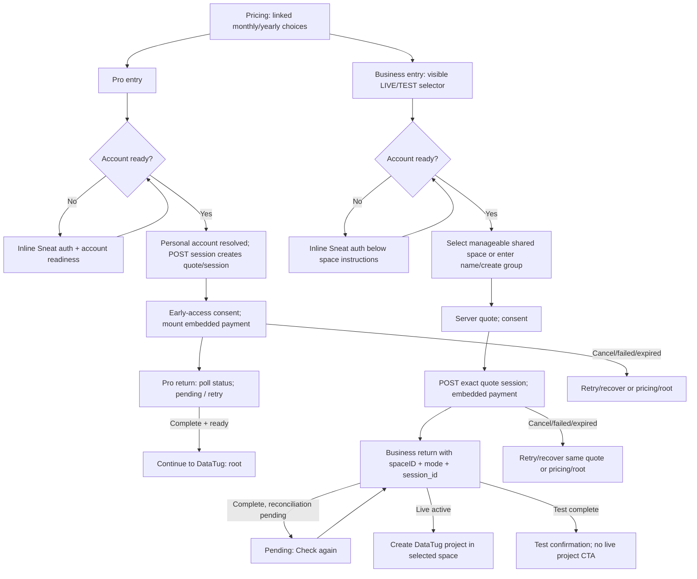
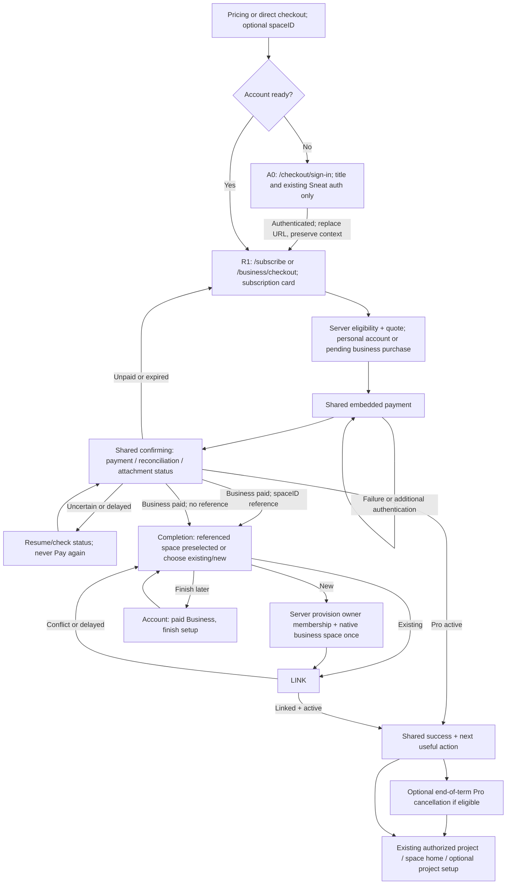

# Feature: Checkout Journey

> [SpecScore.**Studio**](https://specscore.studio): | [Explore](https://specscore.studio/app/github.com/datatug/datatug-apps/spec/features/checkout-journey?op=explore) | [Edit](https://specscore.studio/app/github.com/datatug/datatug-apps/spec/features/checkout-journey?op=edit) | [Ask question](https://specscore.studio/app/github.com/datatug/datatug-apps/spec/features/checkout-journey?op=ask) | [Request change](https://specscore.studio/app/github.com/datatug/datatug-apps/spec/features/checkout-journey?op=request-change) |
**Status:** Implementing
**Source Ideas:** —

## Summary

Review of deployed Pro and Business checkout and a shared purchase flow with post-payment Business space linking.

## Problem

Business asks customers to choose or create a space before payment, while Pro resolves a personal destination automatically. Both flows retain the application side panel on desktop. Their purchase summaries, recovery states and successful destinations differ. A customer should buy either plan through the same short journey, without first creating a project or business space.

The original review was recorded on **2026-10-12**, approved by Alex and merged in app PR #277 (`4b807dda8c5f03bdee123cf9546afaa142662829`). Implementation is in progress. The historical evidence below describes the reviewed state, not a claim that the proposed flow has shipped. No live payments are permitted in this implementation.

## Review evidence and limits

Evidence labels throughout: **B** = observed in deployed browser during this review; **L** = observed on the local server; **S** = inspected implementation / existing local tests; **H** = supplied historical handover or receipt only; **U** = not verified end to end.

| Surface | Reviewed revision / evidence | What it establishes |
| --- | --- | --- |
| App | `10314bdd5b0eeff1c7cfd63c23ad9cea89737376`, matched local `origin/main` at review start | Current checked-out implementation; browser deployment SHA was not independently bound to this SHA |
| Website | `4530167fcdf3f992848a96c16e3d522d43413385`, matched local `origin/main` | Pricing implementation, also checked in deployed UI |
| Sneat shared UI | `cd9ab8bdb482f539d8e83a579a53a092b866a3cc` | Reusable authentication and return-path handling |
| Paymentus / Sneat host | `7bd19e149c27a0b9d49939e0a30b2086111de14e` / `00dddf986b8936157499755d3dad0a47cc03ae2c` | Current local billing ownership, session and provisioning contracts; not deployed backend identity proof |
| Deployed UI | [Pricing](https://datatug.app/en/pricing/), [Pro monthly test](https://datatug.app/subscribe?plan=pro&period=monthly&checkout=test), [Business annual test](https://datatug.app/business/checkout?planID=datatug-business-usage-annual&checkout=test) | Unsigned entry, inline authentication, period controls, rail selector, navigation and desktop side panel |
| Local UI | `http://localhost:18785`, Nx development serve from the reviewed worktree | Pro yearly test entry renders inline auth; Business test stops at “not configured yet” because development configuration has no Business checkout endpoint. No settings were changed |
| Local tests | 10 existing checkout spec files / **129 tests passed**, plus `tools/checkout-flow.test.mjs` / **20 passed** | Component/auth/space/flow/config/privacy contracts with fixtures; not real payment or signed-in browser proof |
| Launch records | [Handover](/Users/alex/projects/handover-datatug-launch-2026-10-05/HANDOVER.md), [delivery receipt](/Users/alex/projects/handover-datatug-launch-2026-10-05/reviews/receipts/business-launch-priority-20261012.json) | Historical reported Business activation/recovery and isolation observations. Do not substitute for current screen verification |

Saved screenshots: [Pro unsigned narrow](02-pro-monthly-unsigned.png), [Business unsigned narrow](03-business-monthly-unsigned.png), [Business annual test](04-business-yearly-test-unsigned.png), [Business desktop](05-business-desktop-side-panel.png), [Pro desktop](06-pro-yearly-desktop-side-panel.png), [local Pro](07-local-pro-yearly-test.png), [local Business](08-local-business-yearly-test.png). The first pricing screenshot captures the page introduction, not annual price evidence.

**Unverified:** authenticated production screens, provider payment/3DS/failure, actual payment return, delayed webhook recovery in this run, new-account provisioning, real Mobile Safari and OAuth/email-link return. Available browser profiles were signed out. No account, space, project, checkout payment or cancellation was submitted. Narrow IAB screenshots are responsive observations, not iPhone Safari testing. Local Telegram reports “Bot domain invalid”; this is a localhost integration limitation, not proof of a deployed failure.

An earlier narrow-screen observation could be mistaken for sidebar suppression: desktop screenshots and the root template confirm that **both Pro and Business still have the side panel**. Pricing radio groups intentionally synchronize; clicking their visible labels worked. Neither observation is treated as a different bug.

## Behavior

### Product direction and common vocabulary

- Use one checkout shell and state sequence for Pro and Business. The differences are the plan summary and destination handling.
- A paying user can purchase and manage subscriptions for several spaces. Buyer/billing authority and beneficiary-space access are separate concepts. Enforce **one active DataTug base subscription per space**, not one subscription per buyer.
- **Pro** is limited to one per user and belongs to that user’s personal space. It can coexist with any number of Business subscriptions.
- **Pro** is a personal-space subscription. The server resolves or provisions the verified user's personal space. No space picker and no project prerequisite.
- **Business** is a business-space subscription. Buy first; select/link an eligible existing space or provision a new business space **after confirmed payment**. An optional `spaceID` reference can nominate an existing destination before purchase without introducing a prerequisite selection screen.
- Authentication establishes the buyer; it is not a request to create a project. Reuse the existing Sneat sign-in/sign-up panel directly on `/checkout/sign-in`, with no intermediary button-only screen. This page contains only the type-specific title, one sign-in sentence, and the login form, with branding and useful exits. Subscription details appear only after sign-in at `/subscribe` or `/business/checkout`. This later user direction supersedes the earlier combined summary/auth design.
- A project is an optional subsequent task. An existing project may be personal or in another space; owning it does not authorize billing a business space or move it into one.
- “Paid”, “reconciled” and “linked to a space” are distinct states. Do not invite a second payment to recover any paid or uncertain state.
- Keep DataTug branding and explicit exit navigation. Hide the application side panel throughout checkout, authentication continuations, payment return, pending confirmation and completion.
- Live is default. The only test entry switch is **`checkout=test`**; no visible LIVE/TEST selector. A passive test notice remains useful.

### Concise scenario matrix

All ten rows can begin at pricing or a valid direct checkout link. A signed-in buyer must have a ready verified account; no row requires a project. “Existing space” below means a server-authorized eligible shared space, not the personal space. Current signed-in paths are **S/U**, not browser-observed claims. Screen IDs refer to the inventory below, which defines fields and primary/Back/Cancel behavior once for every row.

| ID / starting situation | Current Pro | Recommended Pro | Current Business | Recommended Business |
| --- | --- | --- | --- | --- |
| 1. Signed in, existing project and space | C0 → P1 session/price → P2 payment → P3 confirmation → `/`; project not inspected | R1 summary → R2 payment → R3 confirmation → R5; personal space resolved automatically; open authorized existing project or `/home` | C0 → B1 choose eligible space (project's space may be personal/ineligible) → B2 quote → B3 payment → B4 → new-project form | R1 → R2 → R3 → R4 link existing/new → R5; valid optional `spaceID` is preselected for one-click, revalidated attachment; open existing project in linked space |
| 2. Signed in, no project | Same Pro path; project not required | Same Pro path → R5 “Create a project” or explore demo | Same Business path if eligible space exists; otherwise B1 create first; ends new-project form | Same purchase path; R4 link existing/new → R5 → optional R7 project setup |
| 3. Signed in, no company/business space | Same Pro path; business space irrelevant | Same Pro path; no business setup | B1 may still offer manageable ordinary shared spaces (e.g. group); if none eligible, enter name/create group before quote | Buy unchanged; R4 offers existing company business spaces or “New business”; server creates and links once after payment |
| 4. Signed in, neither project nor business space | Same Pro path; personal bootstrap may run | Same Pro path → R5 → optional R7; no business creation | Same qualification as row 3; B1 create if necessary → quote/payment → new-project form | Same purchase → R4 new/existing → R5 → optional R7 |
| 5. New unsigned user, no project or space | C0 → A inline sign-up/sign-in → account readiness/personal bootstrap → P1/P2/P3 → `/` | A0 sign-in/sign-up → account readiness → R1 summary → personal bootstrap → R2/R3/R5 → optional R7 | C0 → B1 space instructions + A inline auth → account ready → B1 create space → B2/B3/B4 → new-project form | A0 sign-in/sign-up → account readiness → R1 summary → pending business billing ownership → R2/R3 → R4 new business provision+link → R5 → optional R7 |

Rows 1–4 are distinct starting conditions but deliberately converge: project presence does not alter purchase eligibility. In rows 3–4, absence of a company-labelled space is not proof of no eligible ordinary shared space. Current code filters personal/private/system/spot/unknown types and owner/admin roles rather than requiring a `company` type. The new post-payment binding uses the native `company` type with current owner/admin authority. The old reviewed picker also admitted groups; legacy subscriptions retain their existing access reader. Conversion or transfer of an ordinary group into the new company-only binding is not implicit.

For **every Pro row**, authentication happens only when absent, personal-space resolution precedes session creation, provider payment precedes activation, and project creation is optional after success. For **every Business row today**, authentication and space authorization/creation precede quote/session/payment; activation follows reconciliation. For **every recommended Business row**, billing ownership precedes payment, space creation/attachment follows verified payment, and usable Business access follows successful attachment. Optional referenced-space validation occurs before payment and again at attachment.

### Current screen-flow diagrams

Solid transitions below are implementation paths; entry/auth/rail/navigation screens were observed, while payment and signed-in branches remain S/U.



### Current screen inventory and rough text wireframes

These are text descriptions, not replacement UI assets. Price values are reviewed pricing values; the authenticated quote UI was source-inspected, not seen with a real account.

| ID | What the user sees / enters | Primary action | Back / Cancel and timing |
| --- | --- | --- | --- |
| C0 pricing **B/S** | Free, Pro, Business; synchronized Monthly/Yearly toggles; crossed regular and launch price, annual saving, VAT/usage/FAQ. No account entry | Subscribe passes Pro `plan=pro&period=monthly|yearly`; Business `planID=datatug-business-usage-monthly|annual` | Browser Back goes prior site. No dedicated Cancel. Test context appends `checkout=test` to checkout links |
| A inline auth **B/L/S** | `Continue with your DataTug account`; SIGN UP / SIGN IN; sign-up email, first name, last name; sign-in email/password and recovery/link options; SSO/provider/Telegram choices. No project input | Existing Sneat form/provider action; wait for accountReady and same-user correlation | Checkout's Back to pricing; Cancel root. SSO/email/provider may navigate outside panel and return. Actual callback U. Shared sidebar remains on desktop |
| P1 Pro review **S/U** | Pro + chosen period; identity; server quote regular/due/discount/tax; early-access/terms copy. No space/project fields, no period switch in checkout | Consent / Continue to payment mounts the already-created exact session | Back canonical pricing, retaining test but losing yearly selection; Cancel `/`. API session is already POSTed while loading authenticated quote, so opening review can reserve a session/place |
| P2 Pro payment **S/U** | Embedded Stripe payment fields and any provider authentication; early-access acknowledgement required first | Provider Pay/subscribe with quoted amount | Checkout exits pricing/root; provider failure stays recoverable. Explicit post-mount Back/session behavior needs browser test. Return includes session_id and mode |
| P3 Pro confirmation/recovery **S/U** | Status checking, pending/expired/error/test complete or success. Success requires complete AND ready. Existing subscription leads account management | Check again / retry when safe; successful Continue to DataTug | Success router `/`; existing subscription `/my`. Root is the public entry, not an existing project destination. Live existing-session recovery differs from test lookup; verify U |
| B1 Business destination **B/S; signed-in U** | `Review Business checkout`; LIVE/TEST control; Monthly/Annual; “Choose Space”; owner/admin eligible spaces or inline new-space name (maximum 100 characters). Unsigned sees instructions and auth first | Select space or Create space; group space creation and membership readiness happen before quote | Back pricing retains `checkout=test` but resets period; Cancel `/`. Creation can persist even if payment is abandoned |
| B2 Business review **S/U** | Selected space/name, current server quote regular/discount/due/tax, early-access consent; selection frozen when session is claimed | Continue to payment posts exact quoteID + spaceID | Same outer exits. Current quote TTL 10 minutes; claimed/uncertain quote is not safely replaceable just because TTL expired |
| B3 Business payment **S/U** | Embedded Stripe fields/provider authentication; visibly rail-specific title/button copy | Provider payment | Same space/session lineage on retry; no proof from client disabled button alone that a server request did not execute |
| B4 Business return **S/U** | Checking, open/pending, expired/error; live access active, or test completed/no live activation. Paid+pending returns pending rather than continuing automatic polling | Check again; live active “Create DataTug project” | Live primary `/new-project?spaceID=…&billingIntent=space_business`, even if a project exists. Test has no live setup CTA. Back pricing/Cancel root; no automatic Pro cancellation observed |
| C-project setup **S/U** | Existing DataTug new-project form, preselected space/billing intent, GitHub/template/project inputs | Create project using existing workflow | Outside purchase; form's own navigation. Project is not an API purchase prerequisite |

Current rough layouts:

```text
PRO                           BUSINESS
[app side panel] [Pro]        [app side panel] [Business LIVE/TEST]
Yearly/Monthly plan           [LIVE] [TEST]  [Monthly] [Annual]
Complete your subscription    Choose Space
[inline auth if unsigned]     [inline auth if unsigned]
Regular / discount / due      [space list] OR [space name] [Create]
[early access consent]        Quote + [early access consent]
[embedded payment]            [embedded payment]
Back to pricing | Cancel      Back to pricing | Cancel
```

### Recommended screen-flow diagram

The shared sequence is **authentication when needed → subscription/payment card → confirmation → completion**. Authentication and the subscription card use distinct URLs. Business adds destination attachment inside completion, after payment. No plan requires a separate project or space prerequisite screen.



### Recommended screen inventory and navigation contract

These screens/states are shared components, not necessarily separate URLs. All use a narrow centered content area with DataTug logo, plan summary and useful exit links; no application side panel, hamburger or unrelated store/incidents links. Authentication callback pages retain the same checkout context and shell. Provider-hosted authentication can have its own unavoidable provider UI.

| ID | Visible information / required input | Primary action | Back | Cancel / exit |
| --- | --- | --- | --- | --- |
| A0 authentication | `/checkout/sign-in` with validated plan/period/optional spaceID/purchaseId/test context. “Complete your DataTug Pro/Business subscription”; one linked Sneat.co sign-in sentence; existing sign-up/sign-in/SSO forms. No price, discount, billing tabs or illustration | Existing authentication action; redirect only after the same user’s account record is ready; no checkout API request on this page | Pricing with selected period and test mode | Public `/`; no space/project creation or charge |
| R1 subscription/payment card | Plan; Monthly/Yearly control; regular price, discount, final due, VAT, renewal terms. Monthly offers annual saving. Signed-in identity + Change account. Pro “For your personal space”. Business without hint “Choose your business space after payment”; valid hint shows destination name. Unsigned users are redirected to A0; existing signed-in users skip A0. Payment button is inside the same standard white Ionic subscription card | “Continue to payment”; early-access acknowledgement once where applicable | Pricing with same plan, period and test context | “Cancel checkout” → validated original in-app source, otherwise `/home` for signed-in or public `/` for unsigned. Unpaid draft remains resumable/expirable; no purchased-subscription cancellation |
| R2 payment | Persistent exact quote summary; provider payment details only; no space/project questions. Billing identity/address/tax fields only as required by provider/merchant | Explicit “Pay €X [per month/per year]” provider confirmation | R1; if quote/session already committed, retrieve/reconcile before allowing changed period; never blindly create a replacement | Same safe exit; payment in flight becomes “Leave checkout” with recoverable status, not an instruction to re-pay |
| R3 confirming | “Checking your payment” then “Payment received; finishing setup” where supported; reference and safe status, no card details | Automatic bounded retry with backoff; “Check status” if delayed; support link/reference | Read-only order summary, no payment form if paid/uncertain | “Finish later” → account purchase record; unsigned/session-expired must reauthenticate to same purchase context |
| R4 Business attachment (completion) | “Business purchased. Choose where to use it.” Eligible existing spaces with role/eligibility, or “New business”; editable business name for new (required only after payment). No project input. Paid/ref status visible. Invalid hint explains why and offers alternatives | “Use this space” or “Create business and finish”; idempotent backend operation | Paid order summary R3; does not undo charge | “Finish later” → `/my` purchase setup item; retain subscription, never silently cancel/refund. If auth expired, A0 and return to the same paid purchase |
| R5 success | Pro active for personal space, or Business active for named linked space; amount/period, launch saving and renewal date; receipt/account link. Test says test-only clearly | Existing authorized project in destination space when available; otherwise “Open DataTug”/space home. Secondary Create project / Explore demo | Read-only receipt/purchase summary | “Done” → validated source or `/home`; paid setup can be resumed from account |
| R6 optional Pro renewal action | Shown only after Business linked/active and an eligible active Pro exists: unchecked “Turn off Pro renewal on DATE; keep Pro until DATE”. Explain both subscriptions otherwise remain active | Separate explicit “Schedule Pro cancellation” action, idempotent; record success/failure independently | Business success R5 | “Keep Pro” or skip → destination; failure does not invalidate Business or auto-retry financial mutation |
| R7 optional project setup | Reuse existing new-project form with destination preselected; project/GitHub/template fields | Existing Create project workflow | Destination space home / prior success | Space home or `/home`; paid access remains active |

R1 and R2 can be progressive states of one page. Do not force another intermediary “review” click if the amount, consent and authentication are already clear. Show subscription details only to signed-in users. A0 never requests a quote or displays price/discount details. R1 shows the selected period and authoritative quote before payment; only a temporary pending quote may be labelled conditional. Never display a reserved discount as guaranteed from the marketing page alone.

Recommended rough wireframes:

```text
/checkout/sign-in?{validated selected checkout context}
DataTug                                      [Test mode, when selected]
Complete your DataTug Business subscription
Sign in with your Sneat.co account to review your price and continue to payment.
[Existing SIGN UP | SIGN IN form and provider options]
Back to pricing                         Cancel and return to DataTug
```

```text
/business/checkout?planID=...&checkout=test&purchaseId=...
DataTug                                      [Test mode, when selected]
Complete your DataTug Business subscription
[Standard white Ionic card]
DataTug Business
[Monthly] [Yearly]                                       VAT included
Regular price                                                  €99.00
Launch discount (30%)                                          −€29.70
Final price                                           €69.30 / month
                         Switch to yearly — 2 months free [dashed underline]
30-day money-back guarantee [Terms]
First-month unlimited users; base payable. Space linking after payment.
[Early-access acknowledgement]
[Continue to payment]
[/Card]
Back to pricing                         Cancel and return to DataTug
```

```text
DataTug                                         Receipt   Finish later
Business purchased
Payment received: €69.30 monthly [example confirmed quote]
Choose where to use Business
( ) Existing eligible space [name ▼]  [eligibility details]
( ) New business [business name — entered after payment]
[Use this space / Create business and finish]
After linking: Business active for Example Ltd
[Open space / existing project]  [Create a project]
[ ] Turn off Pro renewal on DATE; retain access until DATE
[Schedule Pro cancellation]                         [Keep Pro]
```

### Price, period, launch offer and renewal copy

Both checkouts must show **regular subscription price → discount amount/percentage → final price**, only after authentication and alongside payment. Discount is a separate line, not just a struck-through amount. If unavailable, explicitly show €0 discount and why when safe; do not imply the launch price applies to every buyer.

| Plan / period | Regular base | Eligible 30% launch reduction | Final base due |
| --- | ---: | ---: | ---: |
| Pro monthly | €19 / month | −€5.70 | €13.30 / month |
| Pro yearly | €190 / year | −€57 | €133 / year |
| Business monthly | €99 / month | −€29.70 | €69.30 / month |
| Business yearly | €990 / year | −€297 | €693 / year |

These reviewed EUR/VAT-included public values are examples for copy; use the server quote at purchase. **Monthly must promote yearly with “2 months free”** and the full annual amount. Pro: €190 regular annually rather than €228 across 12 monthly payments; Business: €990 rather than €1,188. With the same launch eligibility, annual due is €133 rather than €159.60 / €693 rather than €831.60. Explain annual billing up front; never present an annualized monthly equivalent as the amount charged today. “2 months free” applies to the base subscription, not usage or other add-ons.

Switching period updates the single canonical selection and summary; preserve buyer, optional destination and rail. If a provider session may already exist, resolve it before replacing the quote/session. Pricing Back must restore selected period rather than silently defaulting to monthly. The marketing `yearly` value and existing Business `annual` plan suffix need one explicit mapping, not two independent period states.

Each **eligible subscription** occupies its own launch-discount place. Pro plus Business are separate subscriptions/places; another Business subscription gets its own eligible place. Eligibility is authoritative and currently uses an active-place threshold of 30. Two Business subscriptions for different spaces use two of the 30 places even when the same person pays. No blanket one-discount-per-user rule. Places reopen at effective paid-access end, not when end-of-term cancellation is scheduled. A verified full refund immediately ends paid access and releases that subscription’s place; a partial refund does neither automatically. A paid Business awaiting attachment must already retain its place, and linking must not consume another. Keep live and test availability/reservations separate. Ongoing discount conditions must be repeated accurately from the authoritative offer, not invented by the checkout UI.

Business includes **unlimited active users without extra usage charges during its first subscription month**. The base amount above is payable immediately. For annual purchases this is the first subscription month, not a year of unlimited users and not a free subscription month. Show the applicable date range after confirmation. Further usage terms need clear copy; completing metered billing remains separate work.

Existing pricing FAQ describes an annual cancellation/refund behavior; the requested optional Pro action must explicitly mean **end-of-paid-period renewal cancellation**, including annual Pro, with no immediate revocation or automatic refund. Align the wording and supported backend operation before shipping this option.

### Subscription ownership and shared settings

The commerce record must distinguish `payingUserID`, stable `billingAccountID` / `purchaseID`, `subscriptionID` and optional `beneficiarySpaceID`. A provider customer may be shared by several subscriptions; it is never the uniqueness key for DataTug paid access. The initial Business purchase has billing ownership before a beneficiary exists. Destination binding is a separate, permission-checked operation; binding does not make the paying user a member of the destination or grant project access.

Pro resolves the verified buyer’s personal space, with one Pro base subscription per user. Business requires an eligible ordinary business/shared space at attachment, with one active DataTug base subscription per destination. A user with Pro can buy Business for space A and space B and retain all three. An existing active Business in A blocks a second base subscription for A, including a different payer or billing period; it does not block B. Separate SSO and capacity add-ons do not occupy the base-subscription slot.

Shared Sneat subscription settings should list subscriptions the user has billing authority to manage, with product, beneficiary space (or “Finish setup”), rail, regular/discount/final renewal price, billing period, paid-through/renewal date, cancellation state and next action. Keep subscription management permission separate from ordinary membership and paid feature access. A buyer losing space membership must not silently gain project access through billing settings; administrative billing reassignment needs its own audited authority. Product configuration selects personal/business eligibility, base-service uniqueness and available actions; do not build a parallel DataTug-only billing centre.

Entry: account menu → shared subscription settings; checkout “already subscribed” → the relevant subscription; paid-unlinked confirmation/Finish later → that purchase’s setup item. Open subscription → receipt, renewal/cancellation and eligible configured actions. Back → settings list; Cancel on an unsubmitted management form → subscription details. No settings action silently initiates a checkout or moves projects.

The launch task owns the broader follow-up in [DataTug pricing and billing](https://github.com/datatug/datatug/blob/main/spec/features/pricing-and-billing/README.md), WB task `space-subscription-management`. Shared settings and transfer UI/API are **follow-up work, not checkout launch gates**. The launch checkout must retain sufficient buyer, financial lineage and beneficiary identities for this work.

### Business transfer contract — follow-up only

Transfer changes **paid access only**. Projects, saved queries, data, memberships, identities, audit history and separate add-ons remain in their original spaces. The existing paid-access expiry policy applies to source-space projects immediately after transfer; do not delete or migrate them. Target-space projects gain the remaining base entitlement only after an atomic, authoritative binding change. Project ownership never follows the subscription.

| Concern | Proposed follow-up implementation contract |
| --- | --- |
| Permissions / uniqueness | Verify billing management authority and current destination-management permissions through existing Sneat authority. Recheck both spaces and the current binding in the commit transaction. Source must match the subscription’s current beneficiary; target must be active, eligible and have no active or pending conflicting DataTug base claim. Ordinary membership alone is insufficient. Never grant membership as a side effect. |
| Billing dates / payment | Keep the same provider subscription, customer, currency, period, renewal anchor, paid-through date, cancellation schedule and financial owner. Transfer itself neither charges nor refunds nor restarts a term. Expired, fully refunded or unresolved financial ownership cannot transfer paid access. Scheduled cancellation transfers only the remaining paid term. |
| Launch discount / place | Retain original discount grant, stable place identity, eligibility history and remaining conditions. Transfer consumes no additional place, releases none while subscription remains paid and does not re-evaluate the buyer as a new launch customer. Source-keyed legacy place IDs need an explicit stable-lineage mapping; never recompute the place from the target ID. |
| Introductory first month | Keep its original start/end and already-consumed benefit. A transfer on day 20 has only the remaining introductory period; a later transfer has none. A full refund ends entitlement immediately. |
| Usage already incurred | Retain immutable usage events, original space attribution, payer, pricing version, billing month and invoice lineage. Transfer must not erase, rebill, duplicate or reclassify prior usage as free. Persist an effective cutover timestamp and binding revision. Subsequent target usage uses the same subscription’s remaining billing period; late source events are evaluated against their event-time binding. Metered billing completion remains separate work. |
| Prepaid capacity | Base-bundled capacity, if configured, follows the base subscription with its original period and consumed balance; no reset or duplicate allocation. **Separately purchased** capacity add-ons stay in the source space with their own expiry/billing; do not silently move them. Show this distinction and resulting target capacity before confirming. Independently managed add-on transfer requires separate authorization/work. |
| SSO | Separate SSO subscriptions, verified domains, IdP configuration, login enforcement and identities stay in the original space. Do not move secrets or confer source-domain access on the target. Target keeps its own SSO policy. If a future product bundles SSO in the base, only licence entitlement can follow; target activation still requires its normal domain/IdP verification, with no automatic configuration copy. Preview any resulting source enforcement change. |
| Atomicity / retries | One durable idempotent transfer operation and expected binding revision fence source release and target claim together. Same-operation replay returns the same result. A changed source, occupied target or permission loss returns a conflict with no partial entitlement. Record actor, before/after space IDs and effective time. Provider state is retained, not rewritten to pretend a new purchase. |

Rough follow-up screens:

```text
Account > Subscriptions
Pro · Personal space              €13.30/month · renews DATE [Manage]
Business · Acme                   €69.30/month · renews DATE [Manage]
Business · Northwind              €693/year · renews DATE   [Manage]
Business · Finish setup           Payment received          [Finish setup]

Business > Transfer paid access
Current space: Acme        Paid through: DATE
Target: [eligible existing space / create new through native setup]
Projects stay in Acme. Source access follows normal expiry rules.
Billing, discount and remaining introductory period stay the same.
Separate capacity and SSO add-ons stay in Acme.
[Review transfer] [Cancel → subscription details]

Review transfer
Acme → Northwind · effective on confirmation
Remaining term/benefit, retained usage, source/target access and add-ons
[Transfer paid access] [Back → target selection] [Cancel → details]
Success → subscription details with target + useful target-space link
```

Paid-access-only transfer, unchanged projects, existing permissions and normal access-expiry behavior are confirmed requirements. The financial allocation, base-bundled capacity and SSO handling above are proposed defaults to review before enabling transfer; they do not claim additional approved commercial policy. No transfer endpoint or settings screen is implemented by this checkout change. This follow-up is not a prerequisite for the launch checkout.

### Business purchase ownership without pre-purchase space creation

Today Business quote/session authorization is space-bound: the request requires spaceID, current owner/admin membership and a server-authorized ordinary shared-space scope. Payer, duplicate-purchase fence and offer-place identity derive from that scope. It is insufficient to hide the picker or send an empty spaceID; that would break ownership and reconciliation.

1. **Before payment:** the verified account receives a durable server-created **pending Business purchase intent** in the existing commerce domain, with stable purchase/billing-account identity, buyer authorization, organisation account kind, server-derived rail, plan/period, quote lineage, optional destination reference and discount reservation. This is billing ownership, not active Business access. Reuse the commerce account abstraction; do not bill a personal Pro account as a Business space or invent a dummy usable space. Determine the precise storage home through existing Paymentus/space contracts; user membership remains the authority for eventual space access, not a new ad hoc owner field.
2. **Optional existing `spaceID`:** validate current role, space type and subscription eligibility before presenting the name/quote. A reference is not an access grant. Preserve it across auth. Recheck at binding. A bad/unauthorized hint offers “Continue and choose after payment” or exit, without leaking private space information. Claim the intended destination transactionally when appropriate to prevent two buyers purchasing for the same already-occupied scope; an unresolved conflict must not create a second charge.
3. **At payment:** create/reuse one provider customer and one checkout session for the stable intent using server idempotency keys, quote claim/fence and immutable quote amount. Keep account identity and every operation rail-bound. Do not accept client-supplied provider IDs, success URLs or amounts as authority.
4. **Webhook/reconciliation:** verify server payment evidence and persist paid subscription ownership against the intent even if the browser never returns. No business space is created merely by viewing checkout or abandoning an unpaid session. A paid intent becomes `paid-awaiting-space` until attachment; financial completion does not imply space entitlement.
5. **After payment:** a valid referenced space is preselected in completion, with one explicit activation action and no prerequisite picker. Otherwise R4 selects an eligible existing destination or provisions a new native shared/business space and owner membership **once**, then binds the paid subscription and publishes space access. Creation and binding need a durable coordinated operation: atomically where possible, otherwise recoverable saga with stable IDs and compensation/retry states. Do not repeat provisioning after a timeout or membership-readmodel lag.
6. **Finish later:** retain the paid intent, receipt and “Finish Business setup” item in the account. Server reconciliation/recovery continues without depending on browser polling. Reauthentication recovers the same purchase. Term dates do not silently restart when attachment happens; copy must disclose when billing begins.

Unpaid abandonment releases only safely expired **unclaimed** reservations. Claimed, ambiguous or provider-created sessions must be resolved before releasing a place or starting a replacement. Orphan unpaid intent retention is a backend housekeeping matter. Paid abandonment never deletes the subscription or its discount place. A late membership/eligibility conflict routes to choose another/new space or support/refund resolution, not payment again. Do not automatically transfer projects, members or a subscription between spaces on refresh.

Pro can continue the existing server personal-space resolver/bootstrap; that hidden provisioning is distinct from creating a Business destination. New Business does not require an existing project, company space, company name form or owner-membership editor before payment.

### Edge cases and recovery contract

| Case | Current evidence | Required simpler behavior / verification |
| --- | --- | --- |
| Plan/period/auth preservation | B/S: entry params and SSO returnTo contain plan/period/test; Business optional spaceID propagated in source. Back-to-pricing retains test but loses period | One canonical intent preserves plan, period, destination, safe source return and rail across signup, OAuth, SSO, email link, refresh and redirects. No secrets in URLs/storage/analytics. Verify actual callback, not just link text |
| Existing subscription | S: Pro `already_subscribed` stops retry and leads `/my`; Business server rejects occupied service scope | Show active plan, renewal/date and Manage subscription; resume an existing pending purchase. No new charge for a duplicate destination. New different Business space remains a distinct allowed purchase |
| Permission lost/invalid space | S: owner/admin filtering plus authoritative backend checks; browser U | Validate hint before pay and revalidate after. Before pay allow removal of hint and later selection. After paid keep recoverable paid intent, choose other/new. Never create access from a query string or charge again |
| Payment cancelled/declined/3DS | Provider integration S; no actual provider interaction U | Preserve quote/intent and entered non-sensitive context; provider owns card/3DS fields. Distinguish user exit, definitive failure and unknown outcome. Retry same recoverable session; verify after authentication/back/timeout |
| Payment complete, reconciliation delayed | S: status states; Business paid+pending currently needs manual Check again; H recovery was needed in receipt | “Payment received; finishing setup”, bounded auto-refresh then manual status/support. Keep one durable purchase and resume from `/my`; never show Pay again or success access before backend confirms |
| Refresh/deep link/browser Back | S: generation guards and strict validators; browser end-to-end U | Restore server purchase by safe reference and authenticated buyer. Read-only success on repeated return. Back to unpaid summary cannot recreate a paid session. Invalid/duplicate query keys fail safe, not switch environments |
| Double-click/retry/two tabs | S: client busy flags, quote retry and backend execution fence/idempotency | Server deduplicates intent/session/subscription, destination claim, discount place and provision/link operations. Repeated callback/webhook returns same result. Test dropped response after successful execution and stale tabs |
| Space creation timeout | S: prepay create waits for readmodel, uncertain creation tracked in memory | No prepay business creation. Postpay stable server provision operation resumes known IDs across reload; lag does not trigger another space. Existing space binding has atomic unique subscription constraint |
| Test/live isolation | B: `checkout=test`, passive banners, matching returnTo and pricing links. S: trusted API origins/mode validation. Full provider-return U | Keep established entry flag; returns use `mode=test|live` internally, not another entry selector. Trusted `https://datatug-checkout-test-354fvnqbaa-ey.a.run.app` for test; caller cannot override endpoint. Test IDs/keys/quotes/ledger/activation remain test-only; reject mixed-rail responses and unknown mode. Local test returns to allowed local test origin, production test to production test route; never silently land live |
| Mobile Safari/auth return | Narrow B/L; physical Safari U | Real Safari tests: small viewport, keyboard, safe area, provider iframe/3DS, redirect authentication fallback where configured, email-link/SSO return, popup blocked/cancelled, expired session. Price/period and exit links visible without horizontal overflow. Keep summary accessible while payment fields focus |
| Accessibility | Auth/sidebar DOM inspected; comprehensive keyboard/screenreader U | Explicit field labels; correct radio/button semantics, visible focus, error association, polite status announcements and focus restoration after auth/provider/confirmation. Provider list length must not bury checkout summary/navigation |
| Change account midflow | S: lifecycle disposes provider and rejects stale auth/quote generations | Unmount payment, clear private quote ownership, preserve public selection, revalidate hint and load only new buyer's purchase. Never expose prior user's receipt or bind their paid intent |
| Pro alongside Business | No optional cancellation observed S/U | After Business active offer unchecked explicit R6, current date and paid-through access. Keep both by default. Isolate scheduling failure from successful Business purchase |

### Findings by priority

“Launch blocker” means blocker for shipping the purchase-first flow specified here, not a claim that today's deployed paid service cannot transact.

| Priority | Finding / evidence | Smallest useful change |
| --- | --- | --- |
| Launch blocker | Business cannot quote/pay without a preselected authorized space; inline space creation precedes payment **S/B** | Pending Business commerce ownership + paid attachment contract; remove destination prerequisite UI only when backend supports it |
| Launch blocker | Desktop application side panel remains on both checkouts, including unsigned auth **B/S** | One route/context-aware shell suppression covering checkout and auth/return/confirmation, retaining logo and exits |
| Launch blocker | Visible Business LIVE/TEST selector permits an irrelevant purchase decision **B** | Remove selector; preserve `checkout=test`, validation and passive test notice |
| Launch blocker | Purchase-first paid/unlinked state and idempotent postpay space provisioning do not exist in current contract **S** | Durable paid intent, unique binding/provision operation, account resume, webhook recovery and live/test fences before offering buy-first |
| Launch blocker | Shared price/discount/final breakdown, monthly yearly promotion and safe quote changes must remain authoritative | R1/R2 common summary + annual total, server amount and explicit period/session transition tests |
| Important improvement | Period lost when returning to pricing **B/S**; two plan-specific vocabularies | Preserve selected period, canonical mapping and destinations through all exits/auth |
| Important improvement | Pro success goes root; Business always opens new-project form **S/U** | Destination-aware success with existing project/space home and optional project setup |
| Important improvement | Paid reconciliation pending invites manual recovery; live journey unproved this run **S/H/U** | Clear paid-pending screen, bounded retry, durable `/my` recovery and provider-return tests |
| Important improvement | Existing Pro renewal option absent; annual cancellation copy needs reconciliation | Explicit optional end-term cancellation after Business success, never automatic |
| Important improvement | Long auth provider list and narrow layouts; Safari return unverified | Reuse panel, compact responsive layout and real Safari acceptance; avoid new login intermediary |
| Later work | Meter collection/completion, advanced billing migration, multiple-destination subscription transfer, extensive onboarding | Keep out of this review. Disclose first-month/base terms and preserve current isolation; project templates/onboarding can evolve separately |

### Minimal implementation plan and reuse

Implement only after this Draft's contracts are agreed. Journey order drives the work; no implementation was made in this review.

| Stage | Frontend / reusable component | Backend responsibility / exit evidence |
| --- | --- | --- |
| 1. Common intent and contract | Keep old entry URLs as aliases into a canonical checkout context; map yearly/annual; support optional `spaceID`; schema-safe return target | Paymentus-owned pending Business purchase/account authority; server-derived mode, quote/discount lineage and authorized reader. Inspect storage against space-bounded contracts; do not relax existing space-service auth. Contract tests prove no space/project prerequisite and no unauthorized attach |
| 2. Shared shell, summary and auth | Root `datatug-app.component.html` split-pane suppression; extract small common summary/state shell from existing checkout pages. Reuse `AuthPanelComponent` and `EmailLoginFormComponent` directly from Sneat auth UI; keep accountReady/stale-user guards and safeAuthReturnPath. Use configured redirect fallback on Safari; preserve SSO/email return context and analytics privacy | Existing personal-account bootstrap remains Pro authority; Business gets pending billing authority. Host wires/configures extension endpoints; business logic remains owning modules. All mutations through Sneat HTTPS endpoints, no client Firestore writes |
| 3. Payment and return | Reuse `checkout-api.mjs`, `checkout-flow.mjs`, provider loader/embedded Stripe wrapper and lifecycle disposal; adapt to intent identity rather than invent a second provider integration. Common R2/R3 | Paymentus idempotent customer/session, immutable amount/quote, execution fence, webhook reconciliation, status and paid-pending reader; unique active destination claim. Pro/Business and rail isolation tests |
| 4. Business completion | R4 existing-space selector uses current manageable-space eligibility/readmodel via stable Sneat contracts; new-business minimal postpay form; R5 shared success; account resume. Reuse existing new-project page only for optional R7 | Native Spaceus provision/owner membership via contract port, stable IDs + recoverable bind operation, entitlement publication. Existing-space role recheck and uniqueness. No manual owner-field shortcut, duplicate space or project migration |
| 5. Renewal option and copy | R6 unchecked independent action; website pricing FAQ/handoff period persistence and full price copy | Existing supported subscription scheduling API, or add owned operation if absent; inspect actual end-term semantics before enabling. No automatic Pro mutation |
| 6. Prove journey | Run local current build and changed build on an owned port; seeded fixture auth/space scenarios and isolated provider test flows; screenshots/receipts for each row and error branch | Prove webhook-before-return, return-before-webhook, lost response, repeated callbacks, concurrent tabs and role conflict; no live payment required. Real Safari/auth and test-environment return evidence before launch |

Relevant implementation map (relative links are inside this repository unless absolute):

- [Pro page](../../../apps/datatug-app/src/app/checkout/checkout-page.component.ts), [template](../../../apps/datatug-app/src/app/checkout/checkout-page.component.html), [Business page](../../../apps/datatug-app/src/app/checkout/business-checkout-page.component.ts), [template](../../../apps/datatug-app/src/app/checkout/business-checkout-page.component.html), [space eligibility](../../../apps/datatug-app/src/app/checkout/business-checkout-spaces.ts).
- [API](../../../apps/datatug-app/src/app/checkout/checkout-api.mjs), [flow](../../../apps/datatug-app/src/app/checkout/checkout-flow.mjs), [config/return paths](../../../apps/datatug-app/src/app/checkout/checkout-config.mjs), [Business origins](../../../apps/datatug-app/src/app/checkout/business-checkout-config.ts), [provider](../../../apps/datatug-app/src/app/checkout/checkout-provider.mjs), [auth adapter](../../../apps/datatug-app/src/app/checkout/checkout-auth.ts), [privacy](../../../apps/datatug-app/src/app/checkout/checkout-privacy-state.ts).
- [Root shell](../../../apps/datatug-app/src/app/datatug-app.component.html), [routes](../../../apps/datatug-app/src/app/datatug-app-routes.ts), [project setup](../../../libs/datatug/main/src/lib/project/new-project/).
- [Sneat AuthPanel](/Users/alex/projects/sneat-co/sneat-libs/libs/auth/ui/src/lib/pages/login-page/auth-panel.component.ts), [website pricing](/Users/alex/projects/github.com/datatug/websites/apps/app/src/components/pricing/PricingView.astro), [website handoff](/Users/alex/projects/github.com/datatug/websites/packages/site-kit/src/pricing/checkout-handoff.mjs).
- [Paymentus purchase authority](/Users/alex/projects/sneat-co/paymentus/backend/subscriptions/space_service_test_authority.go), [purchase ownership](/Users/alex/projects/sneat-co/paymentus/backend/subscriptions/space_service_purchase.go), [checkout HTTP](/Users/alex/projects/sneat-co/paymentus/backend/subscriptions/space_service_http.go), [Pro personal resolution](/Users/alex/projects/sneat-co/sneat-go/pkg/modules/datatug/plan_adapters.go), [Spaceus authority contract](/Users/alex/projects/sneat-co/sneat-core-modules/spaceus/contract4spaceus/space_purchase_authority.go).

## Acceptance Criteria

These are future implementation gates; passing current unit tests does not satisfy new behavior.

### AC: scenario-coverage

All ten matrix rows have local fixture-driven screenshots and isolated test checkout receipts; project presence never gates purchase. Pro has no business-space picker; personal bootstrap is server-owned.
### AC: checkout-shell

Shared checkout/auth/return/completion hides the app side panel at desktop and mobile widths, retains branding, and gives the specified Back/Cancel/Finish later destination.
### AC: price-summary

Both summaries show regular price, discount and final amount; monthly promotes yearly “2 months free” with annual due and annual billing terms. Period changes cannot reuse an incorrect-price session. Discount availability is server-confirmed.
### AC: business-after-payment

New Business buyer reaches payment without creating/selecting a business space or project. Optional `spaceID` is preserved/validated, then linked after verified payment. Without a hint, eligible existing/new choice occurs in paid completion.
### AC: durable-attachment

Paid-but-unlinked ownership survives missing return, refresh and auth expiry. Provision/link is idempotent under timeout, two tabs, webhook replay and stale membership readmodel. A permission/subscription conflict after payment does not cause another charge.
### AC: independent-subscriptions

Existing Pro/Business subscriptions route to manage/resume rather than duplicate payment. Another eligible Business scope remains purchasable. Each eligible subscription consumes exactly one launch place; attachment consumes none extra.
### AC: rail-isolation

Only `checkout=test` selects entry test mode; no rail selector. Test/live API, keys, IDs, quotes, ledger, destination entitlement and return handling cannot cross. Test provider redirect returns to its original allowed test environment, including local test callback where configured.
### AC: auth-return

Authentication (email/signup, OAuth redirect/popup, SSO, email link), browser Back and deep-link entry preserve canonical selection and safe return. No credential/client-secret leakage to URL, persisted draft or analytics. Extend continuation privacy checks as needed.
### AC: recovery

Decline/cancel/3DS/expired/unknown/paid-pending states have distinct safe recovery, with no duplicate space, subscription, discount place or charge. Confirmed paid status never leads back to an unguarded Pay action.
### AC: introductory-usage

Business first-month copy says unlimited active users/no extra usage charges and base payable, with dates. Annual is not advertised as twelve free usage months. Metered billing completion is excluded.
### AC: optional-pro-cancellation

Business success offers optional unchecked Pro cancellation at its paid-through date; preserving Pro is default. Separate action success/failure is visible; no automatic cancellation or immediate annual access loss/refund.
### AC: safari-proof

Real Mobile Safari test proves layout, keyboard, provider authentication and login return. Narrow desktop/IAB capture alone is not accepted as that evidence.

### AC: multiple-space-ownership

One user with Pro purchases Business for two different eligible spaces: three independent subscriptions and eligible discount places, with Pro retained. Duplicate base purchase for either space is rejected, including by a second payer. Effective end or a verified full refund releases only that subscription’s place/access. Transfer and settings delivery remain separately tracked follow-up work.

Local review commands, run against the app revision above:

```sh
NX_DAEMON=false NX_ISOLATE_PLUGINS=false pnpm nx run datatug-app:serve:development --host localhost --port 18785
NX_DAEMON=false NX_ISOLATE_PLUGINS=false pnpm nx run datatug-app:test --testFiles=apps/datatug-app/src/app/checkout --watch=false --coverage.enabled=false
node --test tools/checkout-flow.test.mjs
```

The original review run still printed configured coverage despite the requested CLI override; its authoritative result was 10 files/129 passing tests, not full-app coverage readiness. Logs retained for that historical run at `/private/tmp/datatug-checkout-vitest-20261012.log` and `/private/tmp/datatug-checkout-node-tests-20261012.log`. No implementation was changed during that review phase. Subsequent implementation evidence is recorded below. The development server's Business configuration limitation prevents a full local provider journey without separate configured test-environment work.

### Foundation evidence — 2026-10-12 (app PR #278)

The approved implementation remains **Implementing**, tracked in [shared-checkout](../../plans/shared-checkout/README.md). The current slice shares the Pro/Business price presentation, removes the visible payment-rail selector, suppresses the application menu throughout checkout/auth/returns without replacing the router outlet, preserves pricing Back context, and distinguishes the original buyer from the beneficiary in Paymentus status/current-access contracts. It does not claim completion of post-payment Business attachment, optional Pro cancellation, subscription settings or transfer.

Local changed-build observations at `localhost:18785`:

- Pro monthly shows regular €19, conditional discount eligibility, €19/month before an authoritative quote, and the €190 yearly / two-month saving. Inline native Sneat sign-up/sign-in is present. No application panel is visible.
- Selecting yearly updates the URL, price (€190/year), billing controls and authentication return context without reload. Selecting monthly reverses them correctly. This browser test exposed and fixed a stale route-snapshot bug; a regression test supplies a stale snapshot with a newer emitted query map.
- Company SSO opens the existing component with the complete yearly/test return URL and a branded exit header, without an application panel. Authentication completion was not exercised.
- At 390×844, both summaries fit the viewport horizontally and remain scrollable. Business discloses the first-month unlimited-user benefit, payable base and multiple-space ownership. Its local TEST API is unconfigured; no Business authentication/payment success is claimed. Responsive Chromium evidence is not Mobile Safari evidence.

Screenshots: [Pro monthly](09-local-shared-pro-monthly.png), [Pro yearly](10-local-shared-pro-yearly.png), [SSO](11-local-checkout-sso.png), [Business mobile](12-local-business-mobile.png), [Pro mobile](13-local-pro-mobile.png), [inline authentication on mobile](14-local-pro-auth-mobile.png).

Verification: 12 checkout Vitest files / 148 tests passed; the 20 Node checkout-flow tests passed; checkout TypeScript/JavaScript lint passed; zoneless-field and SpecScore validation passed. Final Angular development compilation passed (including the price templates and authentication header). The repository currently provides no HTML lint configuration; Angular compilation and rendered-component tests check templates. Focused coverage output is not whole-app coverage acceptance. Local logs: `/private/tmp/shared-checkout-tests.log`, `/private/tmp/shared-checkout-node-tests.log`, `/private/tmp/shared-checkout-lint-ts.log`, `/private/tmp/shared-checkout-build-final.log` and `/private/tmp/shared-checkout-paymentus-tests.log`.

Paymentus regression proof uses in-memory DAL transactions and fake provider ports. One buyer claims two Business spaces with distinct customer/session idempotency and offer-place identities; another authorized administrator resumes each same-space claim rather than creating another. Two separate TEST places are protected and LIVE remains unchanged. Original initiating buyer identity survives resumption, and identity fields grant no membership. A separate ledger test holds personal Pro plus two Business places, retains a scheduled-cancellation place until effective end, releases only the affected terminal place, rejects stale resurrection and leaves LIVE untouched. Existing financial-normalization tests cover full-base-refund evidence; the ledger test consumes normalized facts rather than pretending to submit a refund. `go test ./subscriptions ./contract4paymentus` passed.

**Remaining work at that foundation snapshot (superseded by the implementation evidence below):** a durable buyer-owned Business billing intent, paid-unlinked reconciliation and post-payment native provisioning/attachment; the current Business endpoint and page still require an eligible space before payment. Preserve that authorization until a complete replacement is wired. Optional end-of-term Pro cancellation also needs a verified owned backend operation. Real provider test payment, authenticated return, delayed reconciliation and physical Mobile Safari proof remain unverified. No live payment, subscription or access-permission mutation was performed.


### Shared Business cutover evidence — 2026-10-12

New `/subscribe` and `/business/checkout` entries share `CheckoutPageComponent`, price summary, provider lifecycle and `/pricing/return`. Unsigned users go to the distinct `/checkout/sign-in` page with the reused Sneat AuthPanel; account readiness redirects them to the selected checkout. Subscription details never appear on the auth page. The old space-first component is retained only for already-issued `/business/checkout/return` links. It is no longer the new-purchase entry. Optional `spaceID` survives authentication and selects the referenced destination after payment; activation still performs a fresh server permission/uniqueness check. Company spaces are eligible in the new binding; personal spaces are excluded.

Paymentus [PR #110](https://github.com/sneat-co/paymentus/pull/110), merged at `a8cc16c8a6ca129feb9467c664c31d5770e64f99`, published backend **v0.52.0**. Host [PR #1249](https://github.com/sneat-co/sneat-go/pull/1249) binds its generic ports to native Core authority; merged at `d9766463b79e506f692fb4a646db114ded64721f`; exact-head post-merge CI and the automatic normal-host Cloud Run deployment passed. This does not prove the separate fixed TEST host has that revision. This app change is the frontend cutover and local proof. Review/acceptance remains **Implementing** until real provider and physical Safari evidence is obtained.

| Area | Implemented contract / evidence | Remaining limit |
| --- | --- | --- |
| Billing before destination | Buyer-owned financial account under verified personal billing home; no business space/project before payment. Stable URL `purchaseId` isolates purchases while same-intent retries reuse ownership/session lineage | New independent deep links without a destination represent new intended purchases; paid unlinked purchases are separate obligations, never silently coalesced |
| Space setup | Paid readiness required. Existing native company owner/admin is checked at attachment, base slot claimed transactionally, capability prepared/applied in the same transaction. New company uses stable native request ID; lost-response retry cannot create another | A refund racing native creation may leave one empty company with no paid access; refund/access fence still wins |
| Abandonment | No company/project for unpaid checkout. Construction-window expiry and provider-proved terminal-unpaid release are distinct; payable/uncertain sessions do not release on a UI timeout. Paid-unlinked subscription remains billable and recoverable from its confirmation link | Shared account settings/resume list is follow-up; this slice retains the purchase return link. No promise that `/my` already lists these purchases |
| Pro choice | Business retains Pro. Eligible owned Pro exposes an unchecked separate end-term cancellation command, keeps paid-through date, and reports its own failure independently | Real provider cancellation not submitted; provider port and owned HTTP mocks cover its semantics |
| Multiple subscriptions / discount | Independent buyer, billing account and beneficiary; one base slot per destination; Pro plus two Business subscriptions take three eligible launch places. Attachment takes no extra place. Effective end/full base refund independently releases access/place | No transfer/settings screen in this change; transfer contract above remains follow-up |
| Price / annual / rail | Shared regular/discount/final quote; monthly offers yearly two-month saving; annual total charged, no free base month. Only `checkout=test` selects the fixed isolated TEST API; no selector. Route/identity generations discard stale results | Real TEST deployment and merchant callback-origin configuration were not changed or proven by local fakes |
| Business introductory usage | Original first subscription month includes unlimited active users/no extra usage surcharge; base remains payable. Linking does not restart dates/benefit | New account-owned usage intake needs the dedicated meter adapter preserving financial identity/frozen usage lineage; existing legacy meter runtime was deliberately left unchanged |

Local evidence uses **real Firebase Auth/Firestore emulators and the existing Sneat email form**, with **simulated checkout/payment HTTP**. Java 21 is needed only by the Firestore test emulator. The five conditions have separate company/project fixture records; new unsigned users sign up within checkout and receive a simulated native profile-init acknowledgement plus persisted emulator profile. Native host bootstrap/provisioning is tested separately with in-memory DAL, not replaced by this browser fake.

- **20 matrix cases passed:** five situations × Pro/Business × desktop Chromium/mobile WebKit. Monthly/yearly prices, TEST origin, stable purchase identity, sign-in/sign-up readiness, browser Back/Forward, refresh, hidden panel, project independence, postpay existing/new destination, and refresh without another attachment. Pro cases end at authoritative quote; Business completion is simulated paid status and setup HTTP, not a real charge.
- **2 additional recovery cases passed:** reconciliation delay → bounded pending → Check again → permission denial → alternative new destination, without any new payment session; optional explicit Pro renewal cancellation submits once. Component tests separately double-click setup and provider mount.
- **160 checkout component/auth/config tests**, **23 Node lifecycle/contract tests**, app lint, zoneless checks, Angular compilation and SpecScore lint passed locally. Focused test coverage is not whole-app coverage acceptance; CI owns the full affected checks. Logs are retained under `/private/tmp/business-checkout-*` for this run; CI now runs `e2e-checkout` with Java 21 and both browser engines.
- [All 20 completion screenshots and four authentication screenshots](local-evidence-20261012.md), including [new Pro user/mobile WebKit](checkout-journey-pro-new-unsigned-user-mobile-webkit.png) and [Business linked/desktop](checkout-journey-business-project-and-business-space-chromium.png). Ionic scroll content means a full-page capture can show only the current inner viewport; interaction assertions cover controls below it. Screenshots visibly identify emulator/TEST mode.

**Still unverified:** real provider TEST charge/decline/3DS, real OAuth/email-link/SSO callback completion, live webhook/return race, fixed TEST-host revision/runtime binding and physical Mobile Safari keyboard/redirect behavior. Mobile WebKit automation is useful layout/return evidence, not a physical iPhone receipt. Local logs expose an existing shared Telegram-widget destroy callback warning during fast auth transitions; it did not block these journeys and remains an auth-library follow-up. No live payment, live subscription cancellation, customer permission mutation or deployment-setting change was performed.

## Open Questions

### Product decisions remaining before implementation

- **Long-unlinked paid Business:** recommendation is to start the paid term at confirmed payment, disclose it before payment, retain recoverable setup and prompt from the account. Decide whether renewal remains normal indefinitely or requires a special long-unlinked reminder/renewal policy. Do not silently defer billing, refund or cancel. This does not block writing this review.
- **Annual Pro end-term option:** confirm public wording consistently distinguishes scheduled renewal cancellation from the current annual immediate-cancellation/refund policy. The requested unchecked end-term option is the proposed default behavior; no immediate cancellation should be inferred.
- **New business naming:** implemented as a short required display name only when creating the destination after payment. Optional default naming can be improved later. No mandatory pre-purchase company-profile form. Formal invoice company details, if legally/merchant-required, belong in payment billing details independently of the space's display name.

The common checkout, post-payment selection, optional `spaceID`, price breakdown/yearly promotion and no automatic Pro cancellation are user-specified directions, not unresolved decisions.

### Implementation questions / evidence still needed

- Resolved: Paymentus server-only personal-home purchase records, mode-partitioned financial identity, stable offer-place lineage and native company base-slot authorization are implemented in backend v0.52.0.
- Resolved: native request-ID-based company creation is replayable; attachment and capability activation share the Paymentus transaction after fresh authority checks. A paid conflict preserves the paid intent for another eligible destination.
- Resolved in implementation: owned Pro period-end cancellation verifies provider customer/product/mode and preserves the paid term. Real TEST provider callback-origin configuration and operation remain unverified; no production settings were changed.
- Deployed backend/frontend revision binding, real authenticated browser paths, Safari/3DS/email/SSO callbacks and paid reconciliation behavior need fresh receipts. Historical delivery claims alone are insufficient.

### Review status

Self-review checked the ten rows, fields/actions/exits, timing, ownership and rail separation against source and captured UI; corrected the narrow-screen sidebar inference and avoided treating radio synchronization as a fault. No independent agent review was run because Alex explicitly requested Sol without additional agents. Alex approved implementation after the review. Implementing status does not imply launch acceptance or verification of the follow-up settings/transfer work.

---
*This document follows the https://specscore.md/feature-specification*


## Checkout presentation refinements, 12 October 2026

- Use a standard white Ionic subscription card. Monthly and Yearly tabs sit directly above price rows; the monthly view puts “Switch to yearly — **2 months free**” immediately beneath the rows, aligned with the amounts and with a dashed underline.
- Show regular price, launch discount and final price only on the signed-in checkout page. The separate authentication page has no subscription details. The server confirms eligibility and final price before payment. Do not add a separate annual billed-total sentence to the monthly view.
- Align the subscription card, inline authentication cards and prompt, and Back/Cancel navigation to the same left edge and width. Put the Test mode chip in the page toolbar. Keep only the small homepage tug illustration; omit the lighthouse.
- Use the type-specific title “Complete your DataTug Pro/Business subscription” on both pages and one prompt above the reused AuthPanel: “Sign in with your Sneat.co account to review your price and continue to payment.” Link Sneat.co. Purchase returns instead remind users to use the same account.
- **Confirmed product decision:** Pro and Business both offer a full refund of each subscription’s first base payment when requested within 30 days, monthly or yearly. Exclude usage, prepaid capacity and separate add-ons. Display the guarantee beside the subscription price and link the shared terms. Requests remain support-managed; a full base refund immediately ends affected access and releases its launch place.

The local emulator matrix uses fake payment-provider responses; it does not submit a provider payment. Real TEST payment/authentication returns, delayed real webhook reconciliation and physical Mobile Safari remain unverified acceptance items.


### Read-only runtime catalog check, 12 October 2026

The normal LIVE host’s `GET /v0/checkout/config?site=datatug&mode=live` returned HTTP 200 and lists both Pro periods as personal-account plans and both Business periods as organisation-account plans. The established fixed TEST host `https://datatug-checkout-test-354fvnqbaa-ey.a.run.app` also returns HTTP 200, `site=datatug`, `mode=test` and the same four plan IDs when the request includes the browser’s `Origin: https://datatug.app` header. An earlier read without Origin returned HTTP 404/non-JSON; this was an invalid probe, not evidence of a broken browser endpoint. This catalog read establishes availability only, not a successful provider payment. The frontend retains the fixed TEST origin and must never route TEST traffic to LIVE. No configuration, subscription or payment mutation was made.

### Playwright coverage and TEST boundary correction

The Playwright suite now takes Pro through TEST confirmation as well as its quote,
and adds payment-loader failure/retry, expired-payment status retry and rejection
of a TEST session paired with a LIVE return URL. All 30 cases in that revision
passed. Four additional Chromium/mobile WebKit cases cover an existing Business
subscription and a referenced-space permission denial, bringing coverage to 34
cases with real emulator authentication and simulated payment HTTP. A regression
also corrected the shared flow: Business `already_subscribed` no longer displays
the personal Pro message, and `not_account_admin` explains the required role.
The opt-in provider suite and commands are documented in the
[e2e guide](../../../apps/datatug-app/e2e/README.md#subscription-checkout).

A read-only Playwright check of the deployed TEST catalog/preflights reproduced
an actual host boundary gap: catalog succeeds, but `purchase-setup` preflight
fails. Source inspection also found the TEST root filter still admitting only
the old Pro session body, rejecting Business `purchaseId`/`spaceId` and the new
setup/options routes. A failing host regression reproduces these paths. The
host correction admits them only with the existing Business TEST arm and exact
app/approved-local origins, preserves the request body and keeps LIVE, unknown
fields, duplicate mode, unrelated origins and unarmed Business paths closed.
Paymentus still owns buyer verification, permissions and financial mutations.
Host [PR #1250](https://github.com/sneat-co/sneat-go/pull/1250) is now landed at
`5139a2b58f7ce1a884960584a261d496e68af571`. Its exact-source normal deployment
(run `38288580962`) passed. Following Alex’s explicit host-first approval, the
dedicated TEST service adopted the same immutable image digest
`sha256:bf5b2d7f3d1a7e563db85fb77de427f0c48c8982a4a6327e50e789d5874fe920`,
with 100% traffic on `datatug-checkout-test-money5139a2b5`. The guard initially
stopped at gcloud removing the client-generated Knative nonce; inspection
confirmed that sole bookkeeping difference. Named-revision promotion then
verified unchanged functional configuration, other metadata and approved IAM.
The deployed Playwright catalog and all three shared POST preflights now pass.
This proves the TEST request boundary and image adoption, not authenticated
provider checkout, payment or reconciliation. Receipts are
`/private/tmp/business-checkout-test-image-adoption.json` and
`/private/tmp/business-checkout-provider-post-adoption.log`.

The already approved local origin is `http://datatug.localhost:4328`, whose TEST
catalog returned HTTP 200. `http://127.0.0.1:18787` is a visual/auth preview and
returns HTTP 404 from that same TEST catalog because it is not an allowed origin.
No allowlist or deployment setting was changed. An existing server owns 4328;
this task neither stops it nor silently replaces its content. Real unpaid form
mounting additionally needs designated TEST buyer auth state outside source Git.
The opt-in suite never enters card details or submits payment, and skips those
authenticated cases explicitly when auth state is unavailable.

### Mobile interaction readiness and opaque returns

CI run `38291504610` passed 33 cases and failed one existing-space Business
activation case. Its trace records no setup request: Ionic still disabled
interaction on the outgoing purchase page while an authentication page covered
it. The shared Playwright helpers now wait for one active checkout page of the
expected kind and `pointer-events: auto` before interacting. Business activation
also finishes field focus/scrolling and centers the ordinary click. There are no
forced clicks, activation retries, arbitrary sleeps or weakened success checks.
Five repeats of the affected mobile case and the complete 34-case matrix pass.

An opaque payment-return link contains mode/session identity, so its subscription
type can be unknown before authenticated status reconciliation. It now uses
“Complete your DataTug subscription” and neutral header branding rather than
guessing Pro. A validated purchase selection retains its type-specific title;
verified Pro or Business completion restores that type. A failing-then-passing
component regression and Chromium/mobile WebKit recovery checks cover this.
All 161 focused checkout/auth/config tests, app lint and zoneless checks pass.
See the [local evidence](local-evidence-20261012.md) for separate receipts; real
provider operations and physical Safari remain unverified.

### Approved account recovery and checkout polish follow-up

The [shared checkout plan](../../plans/shared-checkout/README.md#approved-checkout-recovery-and-polish-follow-up-2026-10-12) records the five approved improvements and their verification. This supersedes the earlier account-resume-list and Telegram-teardown follow-up limits above.

My account now uses Sneat's generic subscription-recovery component to list the signed-in buyer's paid, unlinked Business purchases for the selected rail. Finish later returns there; Finish Business setup opens the original paid session, reconciles its current status and attaches once. Pagination, identity changes, stale evidence, refunds, expiry and live/test partitioning remain server-authorized. This read cannot provision a billing home, create a checkout, or grant access. A buyer without an existing billing home sees an empty list.

The signed-in quote shows Due today, the base renewal amount and period, temporary invitation duration/later rate, and payment-confirmed billing start. Business attachment does not postpone that start. Setup, completion and optional Pro cancellation use standard Ionic cards and controls. Pro cancellation is initially unchecked and requires its own explicit confirmation; projects remain separate from purchase and paid-access transfer remains later work.

The title lifecycle now handles overlapping cached Ionic views, and the published Sneat auth library ignores late Telegram callbacks after teardown. Local evidence covers 972 app unit tests, 25 checkout-flow tests and all 36 browser cases across Chromium/mobile WebKit, using emulator authentication and simulated payment HTTP. Browser checks include account departure/refresh/recovery without a new checkout, delayed reconciliation, permission retry and explicit optional cancellation. A real provider smoke workflow uses normal dedicated TEST-account authentication, verifies Firebase project/UID and mounts unpaid forms only. Its private credentials are not configured here, so real-account/provider execution and physical Mobile Safari remain unverified. No provider payment or customer permission/subscription mutation was performed.


### Approved subscription settings and recovery refinement (2026-10-13)

Alex requested four further improvements: real-provider/device verification, distinguishable unfinished purchases, hiding empty recovery, and shared subscription management. The [implementation plan](../../plans/shared-checkout/README.md#approved-subscription-management-follow-up-2026-10-13) defines the complete navigation and financial/transfer safeguards. Settings use `/subscriptions`, `/subscriptions/:accountId` and `/subscriptions/:accountId/transfer`; the selected rail and transfer request ID survive refresh/authentication. This supersedes the earlier statement that there is no settings/transfer implementation, only after this follow-up is landed and verified. The current-period consumed-allowance settlement restriction is explicit; complete metered billing remains outside scope. Real provider payment and physical iPhone Safari acceptance remain unverified until executed with the designated private TEST fixture and actual device.


See the [subscription-management evidence](subscription-management-evidence-20261013.md) for the current local journey, transfer limitations, dependency delivery and remaining provider/device verification.
