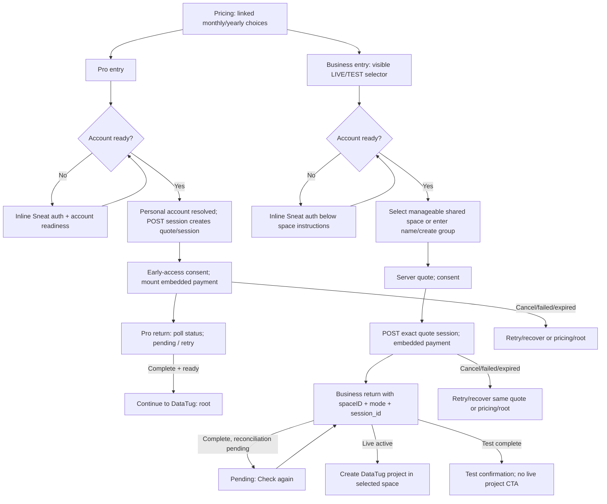
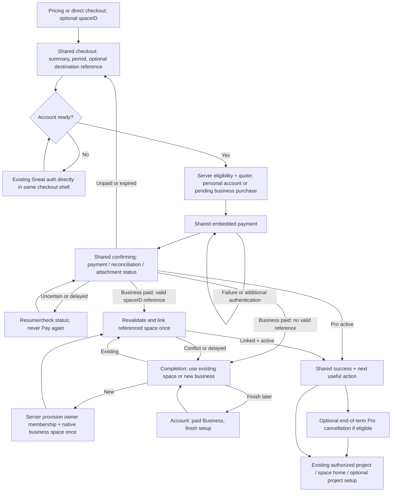

# Feature: Checkout Journey

> [SpecScore.**Studio**](https://specscore.studio): | [Explore](https://specscore.studio/app/github.com/datatug/datatug-apps/spec/features/checkout-journey?op=explore) | [Edit](https://specscore.studio/app/github.com/datatug/datatug-apps/spec/features/checkout-journey?op=edit) | [Ask question](https://specscore.studio/app/github.com/datatug/datatug-apps/spec/features/checkout-journey?op=ask) | [Request change](https://specscore.studio/app/github.com/datatug/datatug-apps/spec/features/checkout-journey?op=request-change) |
**Status:** Draft
**Source Ideas:** —

## Summary

Review of deployed Pro and Business checkout and a shared purchase flow with post-payment Business space linking.

## Problem

Business asks customers to choose or create a space before payment, while Pro resolves a personal destination automatically. Both flows retain the application side panel on desktop. Their purchase summaries, recovery states and successful destinations differ. A customer should buy either plan through the same short journey, without first creating a project or business space.

This is a review and proposed specification, dated **2026-10-12**. No application code, deployment configuration, subscriptions, access permissions or payments were changed. The specification remains Draft; recommendations are not claims of delivered behavior.

## Review evidence and limits

Evidence labels throughout: **B** = observed in deployed browser during this review; **L** = observed on the local server; **S** = inspected implementation / existing local tests; **H** = supplied historical handover or receipt only; **U** = not verified end to end.

| Surface | Reviewed revision / evidence | What it establishes |
| --- | --- | --- |
| App | `10314bdd5b0eeff1c7cfd63c23ad9cea89737376`, matched local `origin/main` at review start | Current checked-out implementation; browser deployment SHA was not independently bound to this SHA |
| Website | `4530167fcdf3f992848a96c16e3d522d43413385`, matched local `origin/main` | Pricing implementation, also checked in deployed UI |
| Sneat shared UI | `cd9ab8bdb482f539d8e83a579a53a092b866a3cc` | Reusable authentication and return-path handling |
| Paymentus / Sneat host | `7bd19e149c27a0b9d49939e0a30b2086111de14e` / `00dddf986b8936157499755d3dad0a47cc03ae2c` | Current local billing ownership, session and provisioning contracts; not deployed backend identity proof |
| Deployed UI | [Pricing](https://datatug.app/en/pricing/), [Pro monthly test](https://datatug.app/subscribe?plan=pro&period=monthly&checkout=test), [Business annual test](https://datatug.app/business/checkout?planID=datatug-business-usage-annual&checkout=test) | Unsigned entry, inline authentication, period controls, rail selector, navigation and desktop side panel |
| Local UI | `http://localhost:18785`, Nx development serve from the reviewed worktree | Pro yearly test entry renders inline auth; Business test stops at “not configured yet” because development configuration has no Business checkout endpoint. No settings were changed |
| Local tests | 10 existing checkout spec files / **129 tests passed**, plus `tools/checkout-flow.test.mjs` / **20 passed** | Component/auth/space/flow/config/privacy contracts with fixtures; not real payment or signed-in browser proof |
| Launch records | [Handover](/Users/alex/projects/handover-datatug-launch-2026-10-05/HANDOVER.md), [delivery receipt](/Users/alex/projects/handover-datatug-launch-2026-10-05/reviews/receipts/business-launch-priority-20261012.json) | Historical reported Business activation/recovery and isolation observations. Do not substitute for current screen verification |

Saved screenshots: [Pro unsigned narrow](02-pro-monthly-unsigned.png), [Business unsigned narrow](03-business-monthly-unsigned.png), [Business annual test](04-business-yearly-test-unsigned.png), [Business desktop](05-business-desktop-side-panel.png), [Pro desktop](06-pro-yearly-desktop-side-panel.png), [local Pro](07-local-pro-yearly-test.png), [local Business](08-local-business-yearly-test.png). The first pricing screenshot captures the page introduction, not annual price evidence.

**Unverified:** authenticated production screens, provider payment/3DS/failure, actual payment return, delayed webhook recovery in this run, new-account provisioning, real Mobile Safari and OAuth/email-link return. Available browser profiles were signed out. No account, space, project, checkout payment or cancellation was submitted. Narrow IAB screenshots are responsive observations, not iPhone Safari testing. Local Telegram reports “Bot domain invalid”; this is a localhost integration limitation, not proof of a deployed failure.

An earlier narrow-screen observation could be mistaken for sidebar suppression: desktop screenshots and the root template confirm that **both Pro and Business still have the side panel**. Pricing radio groups intentionally synchronize; clicking their visible labels worked. Neither observation is treated as a different bug.

## Behavior

### Product direction and common vocabulary

- Use one checkout shell and state sequence for Pro and Business. The differences are the plan summary and destination handling.
- **Pro** is a personal-space subscription. The server resolves or provisions the verified user's personal space. No space picker and no project prerequisite.
- **Business** is a business-space subscription. Buy first; select/link an eligible existing space or provision a new business space **after confirmed payment**. An optional `spaceID` reference can nominate an existing destination before purchase without introducing a prerequisite selection screen.
- Authentication establishes the buyer; it is not a request to create a project. Reuse the existing Sneat sign-in/sign-up panel inside checkout, with no “Sign in to continue” intermediary page.
- A project is an optional subsequent task. An existing project may be personal or in another space; owning it does not authorize billing a business space or move it into one.
- “Paid”, “reconciled” and “linked to a space” are distinct states. Do not invite a second payment to recover any paid or uncertain state.
- Keep DataTug branding and explicit exit navigation. Hide the application side panel throughout checkout, authentication continuations, payment return, pending confirmation and completion.
- Live is default. The only test entry switch is **`checkout=test`**; no visible LIVE/TEST selector. A passive test notice remains useful.

### Concise scenario matrix

All ten rows can begin at pricing or a valid direct checkout link. A signed-in buyer must have a ready verified account; no row requires a project. “Existing space” below means a server-authorized eligible shared space, not the personal space. Current signed-in paths are **S/U**, not browser-observed claims. Screen IDs refer to the inventory below, which defines fields and primary/Back/Cancel behavior once for every row.

| ID / starting situation | Current Pro | Recommended Pro | Current Business | Recommended Business |
| --- | --- | --- | --- | --- |
| 1. Signed in, existing project and space | C0 → P1 session/price → P2 payment → P3 confirmation → `/`; project not inspected | R1 summary → R2 payment → R3 confirmation → R5; personal space resolved automatically; open authorized existing project or `/home` | C0 → B1 choose eligible space (project's space may be personal/ineligible) → B2 quote → B3 payment → B4 → new-project form | R1 → R2 → R3 → R4 link existing/new → R5; valid optional `spaceID` auto-links after revalidation; open existing project in linked space |
| 2. Signed in, no project | Same Pro path; project not required | Same Pro path → R5 “Create a project” or explore demo | Same Business path if eligible space exists; otherwise B1 create first; ends new-project form | Same purchase path; R4 link existing/new → R5 → optional R7 project setup |
| 3. Signed in, no company/business space | Same Pro path; business space irrelevant | Same Pro path; no business setup | B1 may still offer manageable ordinary shared spaces (e.g. group); if none eligible, enter name/create group before quote | Buy unchanged; R4 offers eligible existing ordinary space if any, otherwise “New business”; server creates and links once after payment |
| 4. Signed in, neither project nor business space | Same Pro path; personal bootstrap may run | Same Pro path → R5 → optional R7; no business creation | Same qualification as row 3; B1 create if necessary → quote/payment → new-project form | Same purchase → R4 new/existing → R5 → optional R7 |
| 5. New unsigned user, no project or space | C0 → A inline sign-up/sign-in → account readiness/personal bootstrap → P1/P2/P3 → `/` | R1 shows summary and inline auth → personal bootstrap → R2/R3/R5 → optional R7 | C0 → B1 space instructions + A inline auth → account ready → B1 create space → B2/B3/B4 → new-project form | R1 summary + inline auth → pending business billing ownership → R2/R3 → R4 new business provision+link → R5 → optional R7 |

Rows 1–4 are distinct starting conditions but deliberately converge: project presence does not alter purchase eligibility. In rows 3–4, absence of a company-labelled space is not proof of no eligible ordinary shared space. Current code filters personal/private/system/spot/unknown types and owner/admin roles rather than requiring a `company` type. Post-payment UI must use the backend eligibility result and human wording “business space”.

For **every Pro row**, authentication happens only when absent, personal-space resolution precedes session creation, provider payment precedes activation, and project creation is optional after success. For **every Business row today**, authentication and space authorization/creation precede quote/session/payment; activation follows reconciliation. For **every recommended Business row**, billing ownership precedes payment, space creation/attachment follows verified payment, and usable Business access follows successful attachment. Optional referenced-space validation occurs before payment and again at attachment.

### Current screen-flow diagrams

Solid transitions below are implementation paths; entry/auth/rail/navigation screens were observed, while payment and signed-in branches remain S/U.



### Current screen inventory and rough text wireframes

These are text descriptions, not replacement UI assets. Price values are reviewed pricing values; the authenticated quote UI was source-inspected, not seen with a real account.

| ID | What the user sees / enters | Primary action | Back / Cancel and timing |
| --- | --- | --- | --- |
| C0 pricing **B/S** | Free, Pro, Business; synchronized Monthly/Yearly toggles; crossed regular and launch price, annual saving, VAT/usage/FAQ. No account entry | Subscribe passes Pro `plan=pro&period=monthly|yearly`; Business `planID=datatug-business-usage-monthly|annual` | Browser Back goes prior site. No dedicated Cancel. Test context appends `checkout=test` to checkout links |
| A inline auth **B/L/S** | `Continue with your DataTug account`; SIGN UP / SIGN IN; sign-up email, first name, last name; sign-in email/password and recovery/link options; SSO/provider/Telegram choices. No project input | Existing Sneat form/provider action; wait for accountReady and same-user correlation | Checkout's Back to pricing; Cancel root. SSO/email/provider may navigate outside panel and return. Actual callback U. Shared sidebar remains on desktop |
| P1 Pro review **S/U** | Pro + chosen period; identity; server quote regular/due/discount/tax; early-access/terms copy. No space/project fields, no period switch in checkout | Consent / Continue to payment mounts the already-created exact session | Back canonical pricing, retaining test but losing yearly selection; Cancel `/`. API session is already POSTed while loading authenticated quote, so opening review can reserve a session/place |
| P2 Pro payment **S/U** | Embedded Stripe payment fields and any provider authentication; early-access acknowledgement required first | Provider Pay/subscribe with quoted amount | Checkout exits pricing/root; provider failure stays recoverable. Explicit post-mount Back/session behavior needs browser test. Return includes session_id and mode |
| P3 Pro confirmation/recovery **S/U** | Status checking, pending/expired/error/test complete or success. Success requires complete AND ready. Existing subscription leads account management | Check again / retry when safe; successful Continue to DataTug | Success router `/`; existing subscription `/my`. Root is the public entry, not an existing project destination. Live existing-session recovery differs from test lookup; verify U |
| B1 Business destination **B/S; signed-in U** | `Review Business checkout`; LIVE/TEST control; Monthly/Annual; “Choose Space”; owner/admin eligible spaces or inline new-space name (maximum 100 characters). Unsigned sees instructions and auth first | Select space or Create space; group space creation and membership readiness happen before quote | Back pricing retains `checkout=test` but resets period; Cancel `/`. Creation can persist even if payment is abandoned |
| B2 Business review **S/U** | Selected space/name, current server quote regular/discount/due/tax, early-access consent; selection frozen when session is claimed | Continue to payment posts exact quoteID + spaceID | Same outer exits. Current quote TTL 10 minutes; claimed/uncertain quote is not safely replaceable just because TTL expired |
| B3 Business payment **S/U** | Embedded Stripe fields/provider authentication; visibly rail-specific title/button copy | Provider payment | Same space/session lineage on retry; no proof from client disabled button alone that a server request did not execute |
| B4 Business return **S/U** | Checking, open/pending, expired/error; live access active, or test completed/no live activation. Paid+pending returns pending rather than continuing automatic polling | Check again; live active “Create DataTug project” | Live primary `/new-project?spaceID=…&billingIntent=space_business`, even if a project exists. Test has no live setup CTA. Back pricing/Cancel root; no automatic Pro cancellation observed |
| C-project setup **S/U** | Existing DataTug new-project form, preselected space/billing intent, GitHub/template/project inputs | Create project using existing workflow | Outside purchase; form's own navigation. Project is not an API purchase prerequisite |

Current rough layouts:

```text
PRO                           BUSINESS
[app side panel] [Pro]        [app side panel] [Business LIVE/TEST]
Yearly/Monthly plan           [LIVE] [TEST]  [Monthly] [Annual]
Complete your subscription    Choose Space
[inline auth if unsigned]     [inline auth if unsigned]
Regular / discount / due      [space list] OR [space name] [Create]
[early access consent]        Quote + [early access consent]
[embedded payment]            [embedded payment]
Back to pricing | Cancel      Back to pricing | Cancel
```

### Recommended screen-flow diagram

The shared sequence is **summary/auth → payment → confirmation → completion**. Business adds destination attachment inside completion, after payment. No plan requires a separate project or space prerequisite screen.



### Recommended screen inventory and navigation contract

These screens/states are shared components, not necessarily separate URLs. All use a narrow centered content area with DataTug logo, plan summary and useful exit links; no application side panel, hamburger or unrelated store/incidents links. Authentication callback pages retain the same checkout context and shell. Provider-hosted authentication can have its own unavoidable provider UI.

| ID | Visible information / required input | Primary action | Back | Cancel / exit |
| --- | --- | --- | --- | --- |
| R1 summary/auth | Plan; Monthly/Yearly control; regular price, discount, final due, VAT, renewal terms. Monthly offers annual saving. Signed-in identity + Change account. Pro “For your personal space”. Business without hint “Choose your business space after payment”; valid hint shows destination name. Existing auth panel inline when unsigned; no extra form | Auth action when needed, then “Continue to payment”; early-access acknowledgement once where applicable | Pricing with same plan, period and test context | “Cancel checkout” → validated original in-app source, otherwise `/home` for signed-in or public `/` for unsigned. Unpaid draft remains resumable/expirable; no purchased-subscription cancellation |
| R2 payment | Persistent exact quote summary; provider payment details only; no space/project questions. Billing identity/address/tax fields only as required by provider/merchant | Explicit “Pay €X [per month/per year]” provider confirmation | R1; if quote/session already committed, retrieve/reconcile before allowing changed period; never blindly create a replacement | Same safe exit; payment in flight becomes “Leave checkout” with recoverable status, not an instruction to re-pay |
| R3 confirming | “Checking your payment” then “Payment received; finishing setup” where supported; reference and safe status, no card details | Automatic bounded retry with backoff; “Check status” if delayed; support link/reference | Read-only order summary, no payment form if paid/uncertain | “Finish later” → account purchase record; unsigned/session-expired must reauthenticate to same purchase context |
| R4 Business attachment (completion) | “Business purchased. Choose where to use it.” Eligible existing spaces with role/eligibility, or “New business”; optional editable business name for new. No project input. Paid/ref status visible. Invalid hint explains why and offers alternatives | “Use this space” or “Create business and finish”; idempotent backend operation | Paid order summary R3; does not undo charge | “Finish later” → `/my` purchase setup item; retain subscription, never silently cancel/refund. If auth expired, same inline auth and return |
| R5 success | Pro active for personal space, or Business active for named linked space; amount/period, launch saving and renewal date; receipt/account link. Test says test-only clearly | Existing authorized project in destination space when available; otherwise “Open DataTug”/space home. Secondary Create project / Explore demo | Read-only receipt/purchase summary | “Done” → validated source or `/home`; paid setup can be resumed from account |
| R6 optional Pro renewal action | Shown only after Business linked/active and an eligible active Pro exists: unchecked “Turn off Pro renewal on DATE; keep Pro until DATE”. Explain both subscriptions otherwise remain active | Separate explicit “Schedule Pro cancellation” action, idempotent; record success/failure independently | Business success R5 | “Keep Pro” or skip → destination; failure does not invalidate Business or auto-retry financial mutation |
| R7 optional project setup | Reuse existing new-project form with destination preselected; project/GitHub/template fields | Existing Create project workflow | Destination space home / prior success | Space home or `/home`; paid access remains active |

R1 and R2 can be progressive states of one page. Do not force another intermediary “review” click if the amount, consent and authentication are already clear. Show the selected plan's public price breakdown before authentication, then replace/confirm it with the authoritative quote; label discount availability pending until the server confirms it. Never display a reserved discount as guaranteed from the marketing page alone.

Recommended rough wireframes:

```text
DataTug                         Back to pricing   Cancel checkout
Subscribe to Pro / Business
[Monthly] [Yearly — 2 months free]
Regular subscription                         €19.00 / month
Launch discount (30%, if eligible)             −€5.70
Final price                                  €13.30 / month
EUR · VAT included · billed monthly · renewal terms
Switch to yearly — 2 months free
€190 regular/year → €133/year with launch discount · billed annually
For your personal space / Choose business space after payment
[existing Sneat SIGN UP | SIGN IN panel, only if needed]
[early-access acknowledgement, if required]
[Continue to payment → exact provider fields → Pay amount]
```

```text
DataTug                                         Receipt   Finish later
Business purchased
Payment received: €69.30 monthly [example confirmed quote]
Choose where to use Business
( ) Existing eligible space [name ▼]  [eligibility details]
( ) New business [business name — optional, editable later]
[Use this space / Create business and finish]
After linking: Business active for Example Ltd
[Open space / existing project]  [Create a project]
[ ] Turn off Pro renewal on DATE; retain access until DATE
[Schedule Pro cancellation]                         [Keep Pro]
```

### Price, period, launch offer and renewal copy

Both checkouts must show **regular subscription price → discount amount/percentage → final price**, before auth and alongside payment. Discount is a separate line, not just a struck-through amount. If unavailable, explicitly show €0 discount and why when safe; do not imply the launch price applies to every buyer.

| Plan / period | Regular base | Eligible 30% launch reduction | Final base due |
| --- | ---: | ---: | ---: |
| Pro monthly | €19 / month | −€5.70 | €13.30 / month |
| Pro yearly | €190 / year | −€57 | €133 / year |
| Business monthly | €99 / month | −€29.70 | €69.30 / month |
| Business yearly | €990 / year | −€297 | €693 / year |

These reviewed EUR/VAT-included public values are examples for copy; use the server quote at purchase. **Monthly must promote yearly with “2 months free”** and the full annual amount. Pro: €190 regular annually rather than €228 across 12 monthly payments; Business: €990 rather than €1,188. With the same launch eligibility, annual due is €133 rather than €159.60 / €693 rather than €831.60. Explain annual billing up front; never present an annualized monthly equivalent as the amount charged today. “2 months free” applies to the base subscription, not usage or other add-ons.

Switching period updates the single canonical selection and summary; preserve buyer, optional destination and rail. If a provider session may already exist, resolve it before replacing the quote/session. Pricing Back must restore selected period rather than silently defaulting to monthly. The marketing `yearly` value and existing Business `annual` plan suffix need one explicit mapping, not two independent period states.

Each **eligible subscription** occupies its own launch-discount place. Pro plus Business are separate subscriptions/places; another Business subscription gets its own eligible place. Eligibility is authoritative and currently uses an active-place threshold of 30. No blanket one-discount-per-user rule. A paid Business awaiting attachment must already retain its place, and linking must not consume another. Keep live and test availability/reservations separate. Ongoing discount conditions must be repeated accurately from the authoritative offer, not invented by the checkout UI.

Business includes **unlimited active users without extra usage charges during its first subscription month**. The base amount above is payable immediately. For annual purchases this is the first subscription month, not a year of unlimited users and not a free subscription month. Show the applicable date range after confirmation. Further usage terms need clear copy; completing metered billing remains separate work.

Existing pricing FAQ describes an annual cancellation/refund behavior; the requested optional Pro action must explicitly mean **end-of-paid-period renewal cancellation**, including annual Pro, with no immediate revocation or automatic refund. Align the wording and supported backend operation before shipping this option.

### Business purchase ownership without pre-purchase space creation

Today Business quote/session authorization is space-bound: the request requires spaceID, current owner/admin membership and a server-authorized ordinary shared-space scope. Payer, duplicate-purchase fence and offer-place identity derive from that scope. It is insufficient to hide the picker or send an empty spaceID; that would break ownership and reconciliation.

1. **Before payment:** the verified account receives a durable server-created **pending Business purchase intent** in the existing commerce domain, with stable purchase/billing-account identity, buyer authorization, organisation account kind, server-derived rail, plan/period, quote lineage, optional destination reference and discount reservation. This is billing ownership, not active Business access. Reuse the commerce account abstraction; do not bill a personal Pro account as a Business space or invent a dummy usable space. Determine the precise storage home through existing Paymentus/space contracts; user membership remains the authority for eventual space access, not a new ad hoc owner field.
2. **Optional existing `spaceID`:** validate current role, space type and subscription eligibility before presenting the name/quote. A reference is not an access grant. Preserve it across auth. Recheck at binding. A bad/unauthorized hint offers “Continue and choose after payment” or exit, without leaking private space information. Claim the intended destination transactionally when appropriate to prevent two buyers purchasing for the same already-occupied scope; an unresolved conflict must not create a second charge.
3. **At payment:** create/reuse one provider customer and one checkout session for the stable intent using server idempotency keys, quote claim/fence and immutable quote amount. Keep account identity and every operation rail-bound. Do not accept client-supplied provider IDs, success URLs or amounts as authority.
4. **Webhook/reconciliation:** verify server payment evidence and persist paid subscription ownership against the intent even if the browser never returns. No business space is created merely by viewing checkout or abandoning an unpaid session. A paid intent becomes `paid-awaiting-space` until attachment; financial completion does not imply space entitlement.
5. **After payment:** a valid referenced space attaches without an unnecessary selection screen. Otherwise R4 selects an eligible existing destination or provisions a new native shared/business space and owner membership **once**, then binds the paid subscription and publishes space access. Creation and binding need a durable coordinated operation: atomically where possible, otherwise recoverable saga with stable IDs and compensation/retry states. Do not repeat provisioning after a timeout or membership-readmodel lag.
6. **Finish later:** retain the paid intent, receipt and “Finish Business setup” item in the account. Server reconciliation/recovery continues without depending on browser polling. Reauthentication recovers the same purchase. Term dates do not silently restart when attachment happens; copy must disclose when billing begins.

Unpaid abandonment releases only safely expired **unclaimed** reservations. Claimed, ambiguous or provider-created sessions must be resolved before releasing a place or starting a replacement. Orphan unpaid intent retention is a backend housekeeping matter. Paid abandonment never deletes the subscription or its discount place. A late membership/eligibility conflict routes to choose another/new space or support/refund resolution, not payment again. Do not automatically transfer projects, members or a subscription between spaces on refresh.

Pro can continue the existing server personal-space resolver/bootstrap; that hidden provisioning is distinct from creating a Business destination. New Business does not require an existing project, company space, company name form or owner-membership editor before payment.

### Edge cases and recovery contract

| Case | Current evidence | Required simpler behavior / verification |
| --- | --- | --- |
| Plan/period/auth preservation | B/S: entry params and SSO returnTo contain plan/period/test; Business optional spaceID propagated in source. Back-to-pricing retains test but loses period | One canonical intent preserves plan, period, destination, safe source return and rail across signup, OAuth, SSO, email link, refresh and redirects. No secrets in URLs/storage/analytics. Verify actual callback, not just link text |
| Existing subscription | S: Pro `already_subscribed` stops retry and leads `/my`; Business server rejects occupied service scope | Show active plan, renewal/date and Manage subscription; resume an existing pending purchase. No new charge for a duplicate destination. New different Business space remains a distinct allowed purchase |
| Permission lost/invalid space | S: owner/admin filtering plus authoritative backend checks; browser U | Validate hint before pay and revalidate after. Before pay allow removal of hint and later selection. After paid keep recoverable paid intent, choose other/new. Never create access from a query string or charge again |
| Payment cancelled/declined/3DS | Provider integration S; no actual provider interaction U | Preserve quote/intent and entered non-sensitive context; provider owns card/3DS fields. Distinguish user exit, definitive failure and unknown outcome. Retry same recoverable session; verify after authentication/back/timeout |
| Payment complete, reconciliation delayed | S: status states; Business paid+pending currently needs manual Check again; H recovery was needed in receipt | “Payment received; finishing setup”, bounded auto-refresh then manual status/support. Keep one durable purchase and resume from `/my`; never show Pay again or success access before backend confirms |
| Refresh/deep link/browser Back | S: generation guards and strict validators; browser end-to-end U | Restore server purchase by safe reference and authenticated buyer. Read-only success on repeated return. Back to unpaid summary cannot recreate a paid session. Invalid/duplicate query keys fail safe, not switch environments |
| Double-click/retry/two tabs | S: client busy flags, quote retry and backend execution fence/idempotency | Server deduplicates intent/session/subscription, destination claim, discount place and provision/link operations. Repeated callback/webhook returns same result. Test dropped response after successful execution and stale tabs |
| Space creation timeout | S: prepay create waits for readmodel, uncertain creation tracked in memory | No prepay business creation. Postpay stable server provision operation resumes known IDs across reload; lag does not trigger another space. Existing space binding has atomic unique subscription constraint |
| Test/live isolation | B: `checkout=test`, passive banners, matching returnTo and pricing links. S: trusted API origins/mode validation. Full provider-return U | Keep established entry flag; returns use `mode=test|live` internally, not another entry selector. Trusted `https://datatug-checkout-test-354fvnqbaa-ey.a.run.app` for test; caller cannot override endpoint. Test IDs/keys/quotes/ledger/activation remain test-only; reject mixed-rail responses and unknown mode. Local test returns to allowed local test origin, production test to production test route; never silently land live |
| Mobile Safari/auth return | Narrow B/L; physical Safari U | Real Safari tests: small viewport, keyboard, safe area, provider iframe/3DS, redirect authentication fallback where configured, email-link/SSO return, popup blocked/cancelled, expired session. Price/period and exit links visible without horizontal overflow. Keep summary accessible while payment fields focus |
| Accessibility | Auth/sidebar DOM inspected; comprehensive keyboard/screenreader U | Explicit field labels; correct radio/button semantics, visible focus, error association, polite status announcements and focus restoration after auth/provider/confirmation. Provider list length must not bury checkout summary/navigation |
| Change account midflow | S: lifecycle disposes provider and rejects stale auth/quote generations | Unmount payment, clear private quote ownership, preserve public selection, revalidate hint and load only new buyer's purchase. Never expose prior user's receipt or bind their paid intent |
| Pro alongside Business | No optional cancellation observed S/U | After Business active offer unchecked explicit R6, current date and paid-through access. Keep both by default. Isolate scheduling failure from successful Business purchase |

### Findings by priority

“Launch blocker” means blocker for shipping the purchase-first flow specified here, not a claim that today's deployed paid service cannot transact.

| Priority | Finding / evidence | Smallest useful change |
| --- | --- | --- |
| Launch blocker | Business cannot quote/pay without a preselected authorized space; inline space creation precedes payment **S/B** | Pending Business commerce ownership + paid attachment contract; remove destination prerequisite UI only when backend supports it |
| Launch blocker | Desktop application side panel remains on both checkouts, including unsigned auth **B/S** | One route/context-aware shell suppression covering checkout and auth/return/confirmation, retaining logo and exits |
| Launch blocker | Visible Business LIVE/TEST selector permits an irrelevant purchase decision **B** | Remove selector; preserve `checkout=test`, validation and passive test notice |
| Launch blocker | Purchase-first paid/unlinked state and idempotent postpay space provisioning do not exist in current contract **S** | Durable paid intent, unique binding/provision operation, account resume, webhook recovery and live/test fences before offering buy-first |
| Launch blocker | Shared price/discount/final breakdown, monthly yearly promotion and safe quote changes must remain authoritative | R1/R2 common summary + annual total, server amount and explicit period/session transition tests |
| Important improvement | Period lost when returning to pricing **B/S**; two plan-specific vocabularies | Preserve selected period, canonical mapping and destinations through all exits/auth |
| Important improvement | Pro success goes root; Business always opens new-project form **S/U** | Destination-aware success with existing project/space home and optional project setup |
| Important improvement | Paid reconciliation pending invites manual recovery; live journey unproved this run **S/H/U** | Clear paid-pending screen, bounded retry, durable `/my` recovery and provider-return tests |
| Important improvement | Existing Pro renewal option absent; annual cancellation copy needs reconciliation | Explicit optional end-term cancellation after Business success, never automatic |
| Important improvement | Long auth provider list and narrow layouts; Safari return unverified | Reuse panel, compact responsive layout and real Safari acceptance; avoid new login intermediary |
| Later work | Meter collection/completion, advanced billing migration, multiple-destination subscription transfer, extensive onboarding | Keep out of this review. Disclose first-month/base terms and preserve current isolation; project templates/onboarding can evolve separately |

### Minimal implementation plan and reuse

Implement only after this Draft's contracts are agreed. Journey order drives the work; no implementation was made in this review.

| Stage | Frontend / reusable component | Backend responsibility / exit evidence |
| --- | --- | --- |
| 1. Common intent and contract | Keep old entry URLs as aliases into a canonical checkout context; map yearly/annual; support optional `spaceID`; schema-safe return target | Paymentus-owned pending Business purchase/account authority; server-derived mode, quote/discount lineage and authorized reader. Inspect storage against space-bounded contracts; do not relax existing space-service auth. Contract tests prove no space/project prerequisite and no unauthorized attach |
| 2. Shared shell, summary and auth | Root `datatug-app.component.html` split-pane suppression; extract small common summary/state shell from existing checkout pages. Reuse `AuthPanelComponent` and `EmailLoginFormComponent` directly from Sneat auth UI; keep accountReady/stale-user guards and safeAuthReturnPath. Use configured redirect fallback on Safari; preserve SSO/email return context and analytics privacy | Existing personal-account bootstrap remains Pro authority; Business gets pending billing authority. Host wires/configures extension endpoints; business logic remains owning modules. All mutations through Sneat HTTPS endpoints, no client Firestore writes |
| 3. Payment and return | Reuse `checkout-api.mjs`, `checkout-flow.mjs`, provider loader/embedded Stripe wrapper and lifecycle disposal; adapt to intent identity rather than invent a second provider integration. Common R2/R3 | Paymentus idempotent customer/session, immutable amount/quote, execution fence, webhook reconciliation, status and paid-pending reader; unique active destination claim. Pro/Business and rail isolation tests |
| 4. Business completion | R4 existing-space selector uses current manageable-space eligibility/readmodel via stable Sneat contracts; new-business minimal postpay form; R5 shared success; account resume. Reuse existing new-project page only for optional R7 | Native Spaceus provision/owner membership via contract port, stable IDs + recoverable bind operation, entitlement publication. Existing-space role recheck and uniqueness. No manual owner-field shortcut, duplicate space or project migration |
| 5. Renewal option and copy | R6 unchecked independent action; website pricing FAQ/handoff period persistence and full price copy | Existing supported subscription scheduling API, or add owned operation if absent; inspect actual end-term semantics before enabling. No automatic Pro mutation |
| 6. Prove journey | Run local current build and changed build on an owned port; seeded fixture auth/space scenarios and isolated provider test flows; screenshots/receipts for each row and error branch | Prove webhook-before-return, return-before-webhook, lost response, repeated callbacks, concurrent tabs and role conflict; no live payment required. Real Safari/auth and test-environment return evidence before launch |

Relevant implementation map (relative links are inside this repository unless absolute):

- [Pro page](../../../apps/datatug-app/src/app/checkout/checkout-page.component.ts), [template](../../../apps/datatug-app/src/app/checkout/checkout-page.component.html), [Business page](../../../apps/datatug-app/src/app/checkout/business-checkout-page.component.ts), [template](../../../apps/datatug-app/src/app/checkout/business-checkout-page.component.html), [space eligibility](../../../apps/datatug-app/src/app/checkout/business-checkout-spaces.ts).
- [API](../../../apps/datatug-app/src/app/checkout/checkout-api.mjs), [flow](../../../apps/datatug-app/src/app/checkout/checkout-flow.mjs), [config/return paths](../../../apps/datatug-app/src/app/checkout/checkout-config.mjs), [Business origins](../../../apps/datatug-app/src/app/checkout/business-checkout-config.ts), [provider](../../../apps/datatug-app/src/app/checkout/checkout-provider.mjs), [auth adapter](../../../apps/datatug-app/src/app/checkout/checkout-auth.ts), [privacy](../../../apps/datatug-app/src/app/checkout/checkout-privacy-state.ts).
- [Root shell](../../../apps/datatug-app/src/app/datatug-app.component.html), [routes](../../../apps/datatug-app/src/app/datatug-app-routes.ts), [project setup](../../../libs/datatug/main/src/lib/project/new-project/).
- [Sneat AuthPanel](/Users/alex/projects/sneat-co/sneat-libs/libs/auth/ui/src/lib/pages/login-page/auth-panel.component.ts), [website pricing](/Users/alex/projects/github.com/datatug/websites/apps/app/src/components/pricing/PricingView.astro), [website handoff](/Users/alex/projects/github.com/datatug/websites/packages/site-kit/src/pricing/checkout-handoff.mjs).
- [Paymentus purchase authority](/Users/alex/projects/sneat-co/paymentus/backend/subscriptions/space_service_test_authority.go), [purchase ownership](/Users/alex/projects/sneat-co/paymentus/backend/subscriptions/space_service_purchase.go), [checkout HTTP](/Users/alex/projects/sneat-co/paymentus/backend/subscriptions/space_service_http.go), [Pro personal resolution](/Users/alex/projects/sneat-co/sneat-go/pkg/modules/datatug/plan_adapters.go), [Spaceus authority contract](/Users/alex/projects/sneat-co/sneat-core-modules/spaceus/contract4spaceus/space_purchase_authority.go).

## Acceptance Criteria

These are future implementation gates; passing current unit tests does not satisfy new behavior.

1. All ten matrix rows have local fixture-driven screenshots and isolated test checkout receipts; project presence never gates purchase. Pro has no business-space picker; personal bootstrap is server-owned.
2. Shared checkout/auth/return/completion hides the app side panel at desktop and mobile widths, retains branding, and gives the specified Back/Cancel/Finish later destination.
3. Both summaries show regular price, discount and final amount; monthly promotes yearly “2 months free” with annual due and annual billing terms. Period changes cannot reuse an incorrect-price session. Discount availability is server-confirmed.
4. New Business buyer reaches payment without creating/selecting a business space or project. Optional `spaceID` is preserved/validated, then linked after verified payment. Without a hint, eligible existing/new choice occurs in paid completion.
5. Paid-but-unlinked ownership survives missing return, refresh and auth expiry. Provision/link is idempotent under timeout, two tabs, webhook replay and stale membership readmodel. A permission/subscription conflict after payment does not cause another charge.
6. Existing Pro/Business subscriptions route to manage/resume rather than duplicate payment. Another eligible Business scope remains purchasable. Each eligible subscription consumes exactly one launch place; attachment consumes none extra.
7. Only `checkout=test` selects entry test mode; no rail selector. Test/live API, keys, IDs, quotes, ledger, destination entitlement and return handling cannot cross. Test provider redirect returns to its original allowed test environment, including local test callback where configured.
8. Authentication (email/signup, OAuth redirect/popup, SSO, email link), browser Back and deep-link entry preserve canonical selection and safe return. No credential/client-secret leakage to URL, persisted draft or analytics. Extend continuation privacy checks as needed.
9. Decline/cancel/3DS/expired/unknown/paid-pending states have distinct safe recovery, with no duplicate space, subscription, discount place or charge. Confirmed paid status never leads back to an unguarded Pay action.
10. Business first-month copy says unlimited active users/no extra usage charges and base payable, with dates. Annual is not advertised as twelve free usage months. Metered billing completion is excluded.
11. Business success offers optional unchecked Pro cancellation at its paid-through date; preserving Pro is default. Separate action success/failure is visible; no automatic cancellation or immediate annual access loss/refund.
12. Real Mobile Safari test proves layout, keyboard, provider authentication and login return. Narrow desktop/IAB capture alone is not accepted as that evidence.

Local review commands, run against the app revision above:

```sh
NX_DAEMON=false NX_ISOLATE_PLUGINS=false pnpm nx run datatug-app:serve:development --host localhost --port 18785
NX_DAEMON=false NX_ISOLATE_PLUGINS=false pnpm nx run datatug-app:test --testFiles=apps/datatug-app/src/app/checkout --watch=false --coverage.enabled=false
node --test tools/checkout-flow.test.mjs
```

The test target still printed configured coverage despite the requested CLI override; its authoritative result was 10 files/129 passing tests, not full-app coverage readiness. Logs retained for this local run at `/private/tmp/datatug-checkout-vitest-20261012.log` and `/private/tmp/datatug-checkout-node-tests-20261012.log`. No implementation changed, so there is no changed-build purchase journey to test yet. The development server's Business configuration limitation prevents a full local provider journey without separate configured test-environment work.

## Open Questions

### Product decisions remaining before implementation

- **Long-unlinked paid Business:** recommendation is to start the paid term at confirmed payment, disclose it before payment, retain recoverable setup and prompt from the account. Decide whether renewal remains normal indefinitely or requires a special long-unlinked reminder/renewal policy. Do not silently defer billing, refund or cancel. This does not block writing this review.
- **Annual Pro end-term option:** confirm public wording consistently distinguishes scheduled renewal cancellation from the current annual immediate-cancellation/refund policy. The requested unchecked end-term option is the proposed default behavior; no immediate cancellation should be inferred.
- **New business naming:** recommendation is an optional post-payment editable name with a sensible default. No mandatory pre-purchase company-profile form. Formal invoice company details, if legally/merchant-required, belong in payment billing details independently of the space's display name.

The common checkout, post-payment selection, optional `spaceID`, price breakdown/yearly promotion and no automatic Pro cancellation are user-specified directions, not unresolved decisions.

### Implementation questions / evidence still needed

- Exact pending-business billing account/intent storage and authorization contract in Paymentus, without weakening existing space-service scope; migration of offer-place identity from preexisting-space key to stable subscription lineage.
- Supported transaction/saga boundary for Spaceus provision + membership + subscription attachment; compensation and operational recovery for a paid conflict. Reuse native eligible shared-space type; do not invent an incompatible `business` enum.
- Whether a current API supports scheduled Pro cancellation for monthly and annual; inspect before implementing R6. Runtime test endpoints/local auth/provider return-origin configuration remain to be proved without changing production settings.
- Deployed backend/frontend revision binding, real authenticated browser paths, Safari/3DS/email/SSO callbacks and paid reconciliation behavior need fresh receipts. Historical delivery claims alone are insufficient.

### Review status

Self-review checked the ten rows, fields/actions/exits, timing, ownership and rail separation against source and captured UI; corrected the narrow-screen sidebar inference and avoided treating radio synchronization as a fault. No independent agent review was run because Alex explicitly requested Sol without additional agents. This Draft is a reviewable specification, not implementation or launch approval.

---
*This document follows the https://specscore.md/feature-specification*
